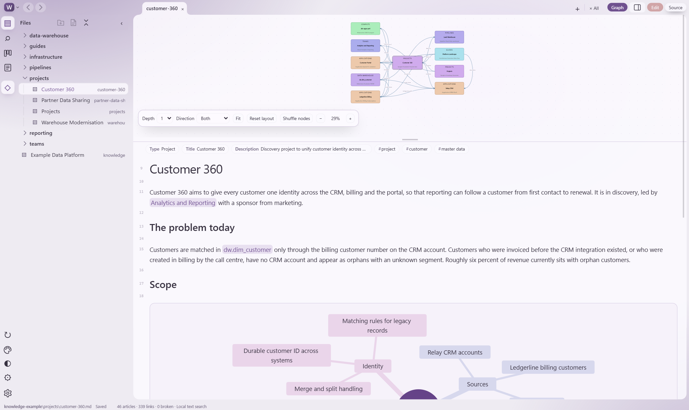
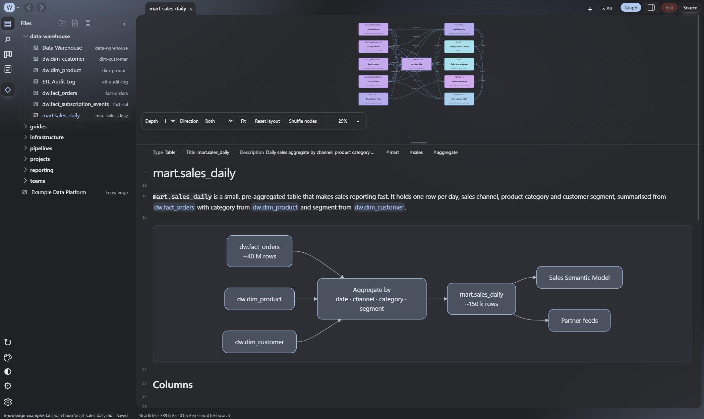
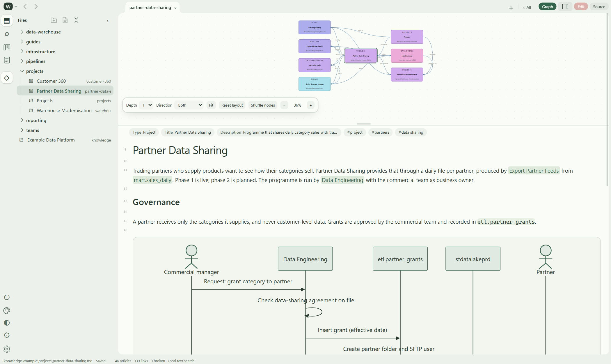
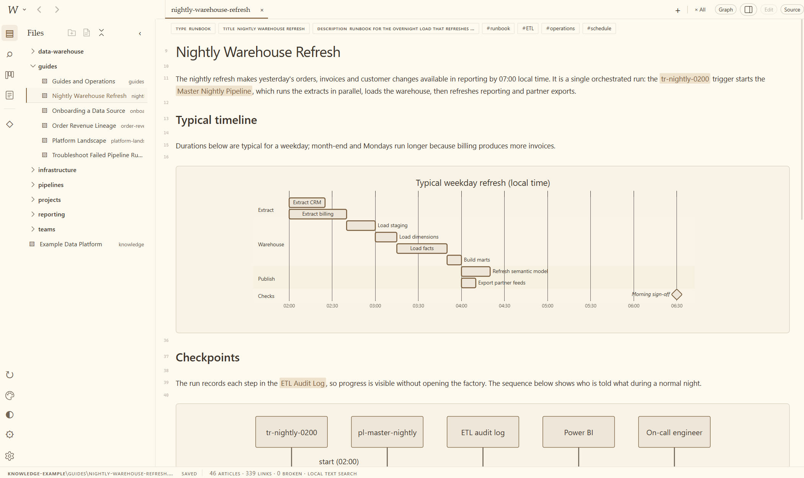
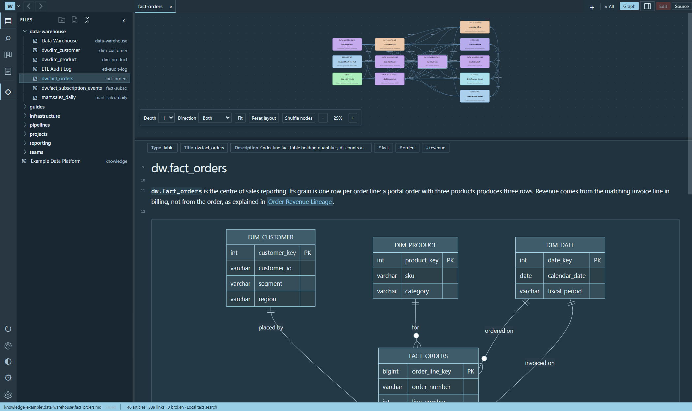
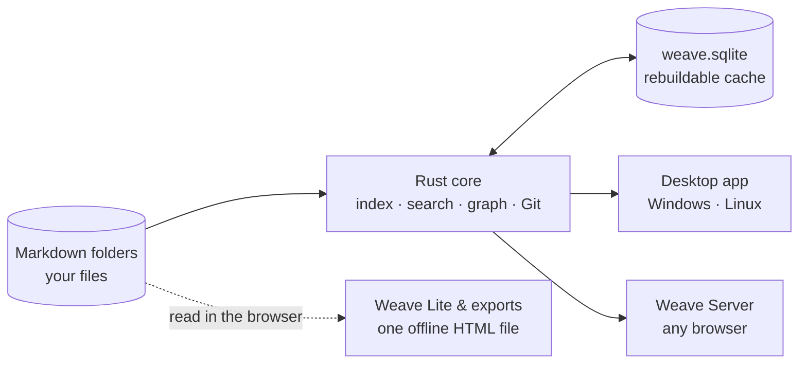
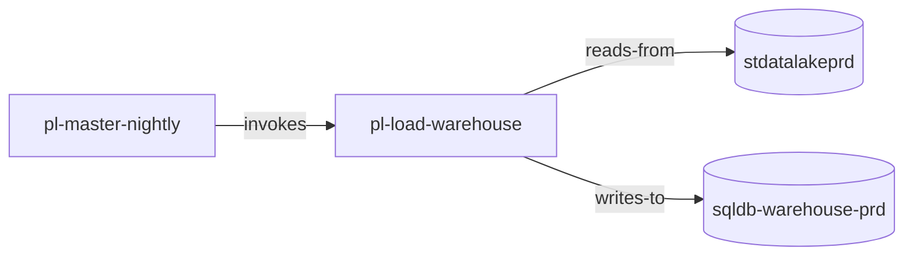

# Weave

**Your team's knowledge, as plain Markdown, with a graph that knows how things connect.**

Weave is a local-first Markdown workspace for structured, shared knowledge. Articles are ordinary [Open Knowledge Format](https://okf.md/) Markdown files in folders you own; Weave adds typed links, a live relationship graph, fast ranked search, built-in Git and a polished editor on top, without ever locking the files into the app. The same files read just as well in GitHub, VS Code or an AI agent's context window.



## Why Weave?

- **Links that say what they mean.** `[Snowflake](./snowflake.md "depends-on")` is a normal Markdown link that also tells the graph *how* two things relate, so you can answer "what feeds this table?" rather than only "what mentions this note?".
- **Portable by default.** Relative links, optional OKF frontmatter, no `[[wiki links]]` and no proprietary database. Your library works without Weave.
- **Several workspaces at once.** Keep personal notes beside team and organisation knowledge bases in one window, each with its own colour, and search across all of them.
- **Git built in.** Stage, commit, diff, branch, sync to several remotes and resolve merge conflicts visually, with no plugin. A guided setup connects a workspace to GitHub with a deploy key, from the desktop or any browser.
- **Share a whole knowledge base as one file.** Export a workspace as a single offline, read-only `.html` file anyone can open in a browser.
- **Fast and small.** A Rust backend with embedded SQLite FTS5, a native WebView instead of a bundled Chromium, and an interface that stays responsive at hundreds of thousands of articles.
- **Made for agents too.** Plain files, prose relationships, a validator and authoring rules mean AI agents can read and maintain the same knowledge you do.

## Make it yours

Skins change the shape of the interface; colour schemes change its palette. Every skin works with every scheme.

| | |
|:---:|:---:|
|  |  |
| **Aurora Flow** · Graphite | **Studio Flow** · Sage |
|  |  |
| **Editorial** · Warm paper | **Compact** · Ocean |

## How it fits together

Your Markdown folders are the source of truth. One Rust core indexes them and serves every way of reading them.



A typed link is just a Markdown link with a relationship in its title. In `pipelines/pl-load-warehouse.md`:

```markdown
It reads the night's files from [stdatalakeprd](../infrastructure/data-stores/stdatalakeprd.md "reads-from")
and loads them into [sqldb-warehouse-prd](../infrastructure/data-stores/sqldb-warehouse-prd.md "writes-to").
```

Weave turns those links into a directed, labelled graph:



## Get started

**Windows.** Run `Weave.exe`: a single portable executable with no installer (requires the WebView2 runtime built into Windows 10 and 11).

**Linux and ChromeOS.** Install the `.deb` for amd64 or arm64, or unpack the `.tar.gz` and run `./weave`. See [docs/LINUX.md](docs/LINUX.md).

**Self-hosted.** `docker compose up -d --build`, then open `http://localhost:8765`. See [docs/SERVER.md](docs/SERVER.md).

Choose **Open workspace folder…** from the **W** menu and pick any folder of Markdown. To try it out, open the bundled [`knowledge-example/`](knowledge-example/) library: a fictional data platform with 46 linked articles and 51 diagrams.

## Documentation

| Guide | What's inside |
|---|---|
| [User guide](docs/USER_GUIDE.md) | Workspaces, tabs, the graph, search, editing, Kanban, Git, exports and settings |
| [Authoring format](docs/AUTHORING.md) | Links, relationship types, frontmatter, tags and Kanban fields |
| [Developing Weave](scripts/README.md) | Building, testing, packaging and benchmarks |
| [Web server](docs/SERVER.md) | Hosting Weave for browsers, authentication and deployment |
| [Linux](docs/LINUX.md) | Linux packages, ChromeOS and the Linux build machine |
| [Architecture](docs/WEAVE_ARCHITECTURE.md) | How the pieces fit, in more detail |
| [Performance](docs/PERFORMANCE.md) | The responsiveness design, budgets and measurements |
| [Skins](app/weave/skins/README.md) | Writing a new interface skin |

Contributors and AI agents should also read [AGENTS.md](AGENTS.md).
