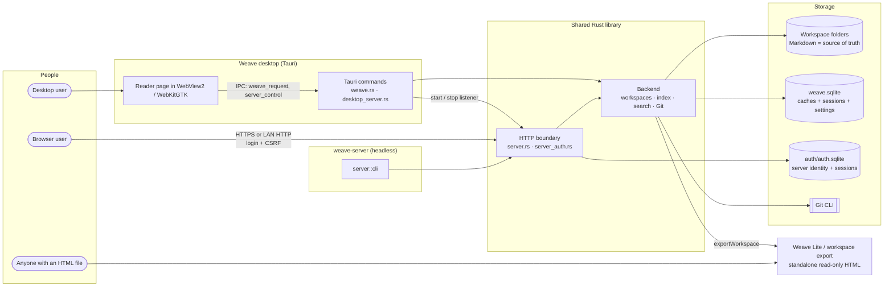
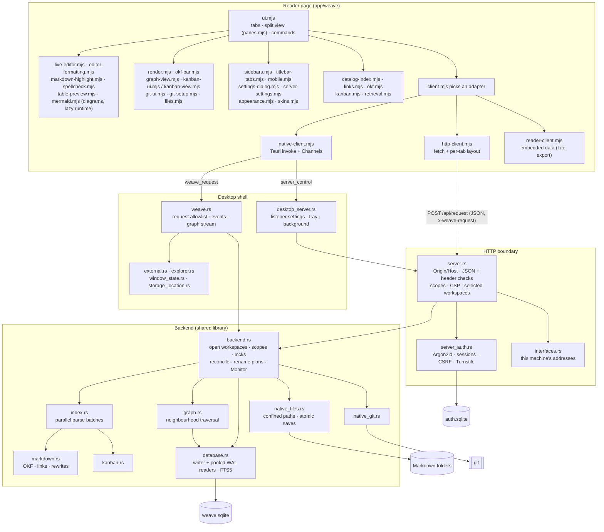

# Weave architecture

The desktop embeds a stoppable HTTP listener on the same Backend and monitor. Desktop/server ownership of each workspace is independent: desktop layout excludes server-only roots, and closing either delivery host leaves the other’s scope and watcher intact. `desktop_server.rs` owns persisted listener configuration, tray and background lifecycle; `server.rs` owns the common CLI and HTTP boundary. Desktop `server`/`--server` dispatch happens before all Tauri initialisation.

The shared library also serves the headless `weave-server` binary behind the optional `server` feature, with Tauri dependencies gated behind the default `desktop` feature. `server.rs` confines CLI grants to direct children of the configured workspace root; desktop hosting grants the selected known workspace IDs and their frozen canonical roots and admits only explicit workspace scopes through HTTP. `http-client.mjs` reuses the native resource/capability adapter while retaining each browser tab's layout locally. [SERVER.md](SERVER.md) describes protocol, security and deployment boundaries.

Markdown is authoritative. Desktop Weave is a Tauri application with an in-process Rust backend and statically linked SQLite/FTS5. It neither ships nor starts Node, model workers, embedding libraries or download clients. Node 24+ is a development dependency for frontend bundling, browser previews and test runners.

## Architecture at a glance

Two diagrams show Weave at different levels of detail. The first shows the deliverables and how each one reaches articles; the second shows the components inside the shared reader and the shared Rust library. Both are [Mermaid](https://mermaid.js.org/) diagrams, rendered by Weave itself, GitHub and most Markdown viewers.

### Level 1: deliverables and hosts

One reader page is built in several forms. Each form talks to its host through a client adapter, and every writable host runs the same Rust `Backend` over Markdown folders and one SQLite database.



The desktop can host the HTTP boundary itself (sharing its Backend, monitor and write locks) or Weave Server can run it headless with its own data directory. Weave Lite and exports embed their articles and make no requests.

### Level 2: components

The reader is one set of browser modules for every host; only the client adapter differs. In Rust, the Tauri shell and the HTTP boundary are thin adapters over the same `Backend`, which owns every file, index and Git operation.



Requests run concurrently on the one `Backend` without a global lock; each open workspace has short `write`, `scanning`, `git` and `plan` locks. The Monitor turns file-watcher notifications into path-level reconciliation and `weave-changed` events. Browser requests can reach only the operations in `server.rs`'s allowlist; desktop-only controls (`server_control`, root grants, storage relocation, export paths) never cross the HTTP boundary.

## Native service boundary

| Module | Responsibility |
| --- | --- |
| `src-tauri/src/weave.rs` | Tauri state: one shared backend, the background monitor, scoped change events, graph streaming and shutdown |
| `backend.rs` | Open-workspace lifecycle and per-workspace locks, incremental reconciliation, labels and window layout, sessions and settings, rename plans, evidence, metrics |
| `index.rs` | Article preparation off the database lock, in parallel: decoding, OKF metadata, chunks, links and their resolution |
| `native_files.rs` | Confined filesystem access, walks from directory listings, encoding, conflict checks, atomic replacements, recovery copies |
| `markdown.rs` | OKF article metadata, links, resolution and destination-span rewriting |
| `kanban.rs` | Kanban boards, columns and card references from OKF frontmatter; card `board` values rewritten when boards move |
| `database.rs` | Unified schema, one writer and pooled WAL readers, incremental index transactions with maintained counts, per-workspace FTS5/BM25, catalog tree and changes |
| `native_git.rs` | Scoped Git CLI operations, diffs, branches, remotes, conflict resolution and sync; automatic snapshots, their repository lease and restores; per-workspace SSH deploy keys, and the hardened mode used for HTTP requests |
| `graph.rs` | Neighbourhood traversal read from the index on demand, streamed by depth over Tauri Channels |
| `backend.rs` export | Portable workspace export: fills the embedded reader template (`EXPORT_TEMPLATE`) with articles, metadata and graph |
| `external.rs`, `explorer.rs`, `window_state.rs` | Individually granted external Markdown files, native reveal and window placement |

`weave_request` carries the reader's named operations and calls Rust directly through Tauri IPC; there is no production JSON-lines transport. The native picker grants workspace roots; `open` is intentionally absent from the frontend request allowlist. `health` protocol 3 advertises independent write, Git, storage, session, native-window, graph-stream, logical-resource and FTS capabilities. Removed model/index-management operations are rejected.

Blocking filesystem, SQLite and Git work runs outside the WebView, and requests run concurrently: each Tauri command runs on its own blocking thread against one shared backend, with no global lock. Each open workspace has its own short locks: one serializes its file writes and index transactions, one its full scans, one its Git service and one its rename plan. Reads (documents, search, catalog, status, graph, Kanban) take none of them; they use pooled read connections and see the last committed index. So a Git fetch, a full scan or a large rename never delays reading, searching or saving elsewhere, and a save waits at most for one index batch. Up to 12 workspaces are open at once, each with its own watcher, rename plan and Git service; no article text is held in memory. Opening a workspace issues a process-unique scope; every workspace request names its scope and is routed to that workspace, and resources additionally carry its workspace identity. Closed scopes and foreign resources are rejected before filesystem access. `open`, `restore`, `close`, `reopen` (a previously granted root only, by workspace ID), `workspaceLayout`, `configureWorkspace`, `controlPanel` and `configureStorage` are not scoped. The frontend binds one client view to each open workspace's scope. Logical paths are absolute within the grant (`/Systems/Note.md`), never physical filesystem authority. Authored Markdown links remain relative article identities. Native commands expose neither arbitrary SQL nor arbitrary process execution.

The watcher records the paths each native notification names (up to 10,000; beyond that, or when the OS reports lost events, the workspace is marked for a full scan). Every 250 ms the monitor starts reconciliation for each workspace with queued work on that workspace's own thread, so a large scan of one never delays another, and reports each changed revision as a `weave-changed` event with scope and status. Queued paths are reconciled individually: a changed file is read again, a removed file or folder leaves the index with everything under it, a new folder is walked, and missing ancestor folders are added. Full scans run only at start-up, after lost notifications, on the periodic safety schedule (settings retain file watching, automatic refresh, intervals from 10–86400 seconds, default 300, and metadata/full-content comparison) and on Refresh, which compares content. A full scan walks the tree from directory listings (no per-file system calls on Windows), merges it in path order with the stored tree and reindexes only new or changed articles; unchanged articles are never read. Opening a workspace returns its stored tree at once and reconciles in the background; a small workspace opened for the first time is indexed before `open` returns.

Indexing runs in batches of 384 articles. One thread reads and parses the next batch (in parallel, one reader per core, four to eight) while the current batch is written, through a one-batch channel, so memory stays bounded and parsing overlaps writing. An article whose content still has the stored hash is read and hashed but not parsed, so a content Refresh costs a read per article. Each batch resolves its links against just the articles sharing their filenames, read from `entries`; no whole-workspace resolver is held. Each write is a short transaction under the workspace's write lock that first checks the stored hash is still the one planned (compare-and-swap), so a concurrent save is never overwritten by an older read; a removal applies only if the path is still absent with exactly that name (case-only renames included). New tree rows are written first so the Files tree appears before articles are parsed; a changed article's tree row is written with its index rows, so an interrupted run never pairs a current row with stale text. Index transactions use `synchronous=NORMAL` (WAL cannot corrupt; a power cut can lose only the newest derived rows, which the next scan restores); settings, sessions and Git preferences keep `FULL`. Weave's own saves, creations, deletions, renames, Kanban saves and Git actions index exactly the paths they changed. When articles appear or disappear, only stored links whose target filename matches theirs are resolved again (`target_key`), using a resolver built from just the articles sharing those filenames, which answers exactly as a resolver of the whole workspace would. Shutdown signals the workers, cancels active Git work, joins the monitor, releases watcher/OS locks and closes SQLite. No child service survives exit.

`app/weave/tests/native-harness.mjs` uses an opt-in `weave-test-host` binary to expose the same Rust backend to browser tests. Its line transport exists only in that test executable, behind Cargo's `native-test-host` feature; it is never packaged or launched by Weave.

## One SQLite database

`weave.sqlite` contains all registered workspaces. SQLite is compiled with FTS5 through `rusqlite`'s bundled library; no runtime extension is loaded. The database uses WAL, foreign keys, a three-second busy timeout and a versioned schema (3). One writer connection applies transactions; up to six pooled read connections (`query_only`) serve requests concurrently. WAL/SHM files are transaction companions, not additional application databases.

| Table | Data |
| --- | --- |
| `settings` | Open workspaces in order with window-wide tabs whose histories may span workspaces, tab order and active tab (`workspaceLayout`), delete-backup preference (`deleteBackups`), per-workspace name/colour (`workspaceLabel:<id>`) and workspace monitoring settings |
| `workspaces` | Stable workspace key, canonical root, display name, session JSON and Git preference/history JSON |
| `entries` | The tree: every folder, Markdown file and other file with kind, modification time, size and lower-cased filename key. It answers the catalog, plans full scans and builds exact link resolvers |
| `documents` | Workspace/path key, source hash, modification time, title and article metadata |
| `relationships` | Workspace/source/offset key, resolved target, lower-cased target filename key and complete authored relationship record |
| `chunks` | Stable chunk ID, workspace/path, ordinal, byte/line ranges, source/content hashes, title and body |
| `fts_<workspace>` | One contentless FTS5 index per workspace (`contentless_delete`) over chunk title, path and body, keyed by chunk rowid and written with the chunks |
| `stats` | Per-workspace counts of documents, links, unresolved links and chunks, updated by every index transaction (status reads them without counting rows) |
| `kanban_boards`, `kanban_columns`, `kanban_cards` | Boards (with folded filename and path keys and column warnings), their columns in board order, and each card's authored board value, lookup key, column id and rank |

Documents and graph/search/Kanban rows are derived from Markdown. Sessions and preferences are durable data: deleting the whole database also deletes them. Workspace-scoped composite keys and query predicates prevent identical paths in different workspaces from colliding. Closed workspaces keep their rows but are not rescanned or searched. Adding/removing a path re-resolves existing links because a new basename can introduce ambiguity; ordinary edits replace only changed documents, chunks and outgoing links. Unchanged chunks retain their IDs across refresh and restart.

Catalog requests return the tree with titles only where they differ from the filename. Each committed change records its paths in a bounded in-memory log (20,000 paths), so `catalogChanges {since}` returns just the rows added, changed or removed since a revision, or `reset` when the client is older than the log. Opening, restoring and refreshing leave out the trees of workspaces with more than 20,000 articles (`tree.partial`); the reader shows the first article, then loads the tree with `catalogPage {after, limit}` (path-ordered pages of up to 20,000 rows) between frames and swaps it in. `catalog` still returns the whole tree.

Chunks are at most 1,800 UTF-8 bytes with roughly 200 bytes of overlap. Splits prefer newline boundaries in the second half and never split a Unicode code point. Empty notes receive a title/path-searchable empty chunk. IDs hash workspace identity, path, ordinal and chunk content hash. Source hashes match the file-byte hash used by conflict-checked document reads; byte offsets describe decoded UTF-8 text. Line ranges are one-based. These records can later be referenced by vector rows in this same database. No vector table, model fingerprint or embedding execution is currently implemented.

FTS5 uses `unicode61 remove_diacritics 2`. Rust converts bounded user text into quoted MATCH operands: terms are ANDed, quoted phrases preserve adjacency, a trailing `*` requests a token prefix, and `-term` excludes an operand. Raw SQL/MATCH syntax is never interpolated. BM25 weights title/path/body at 8/4/1. A search reads only its workspace's index. It ranks chunk rowids with a bounded top-k (at least 200, eight per requested article), keeps the best chunk per article and, when fewer distinct articles than requested were found among a full set of hits, widens the bound fourfold (up to 20,000), so the best articles are exact without sorting every match; passage bodies are loaded only for the winners. Results carry the chunk ID, source hash, excerpt and line range. Corpus statistics are per workspace. A search sent with a `searchChannel` interrupts the previous search on that channel and workspace, which returns `cancelled`; the live search box uses one, so typing never queues stale searches. While a workspace is first indexed, searches return what is indexed with a notice. The reader searches each open workspace separately and groups the results. Search is token-based rather than arbitrary substring matching, and terms split across non-overlapping chunks may not match together.

Deep search takes up to five seed articles and optionally expands one link hop, up to twenty documents. It returns `{version, question, generated:false, retrieval, notices, truncated, documents}`. Each source has a filepath, source hash, passage and relationships; linked sources include the edge that justified inclusion. Evidence rereads current Markdown and replaces a stale indexed seed passage with current text. This is an evidence service, not answer generation.

## Kanban

A board is an article with `type: Kanban Board`; its ordered columns (`id`, `title`) are `weave.kanban.columns` in its frontmatter. A card is any article with `weave.kanban.board`, `column` and a numeric `rank`. Indexing replaces a changed document's Kanban rows with its graph and chunk rows, in the same transaction. A card's `board` value is stored as authored with a lookup key: a bare filename matches boards by folded filename (board filenames are unique in a workspace), and a value containing `/` is normalized as a path relative to the card or, with a leading `/`, the root. Resolution and validation happen at query time: `kanban` returns every board with its columns, duplicate filenames and counts, and every card with a status (`ok`, `unknown-column`, `no-column`, `missing-board`, `ambiguous-board`); `kanbanBoard` returns one board and every card naming it. Malformed card data never changes a board. Schema version 2 added these tables and version 3 the tree, keys, counts and per-workspace search indexes; upgrading deletes derived rows so the next reconciliation rebuilds them from Markdown, as deleting the database does, while sessions and settings remain.

The frontend edits frontmatter with the `yaml` document API (`kanban.mjs`, preserving comments and other keys), stamps it like other saves and writes through `kanbanSave`, which checks every article's hash before writing any and reconciles once. Moves write one card's `column` and `rank` (a short decimal between its neighbours); only when no readable rank remains, or a neighbour has none, is that column renumbered. Rename/move previews rewrite card `board` values that would stop finding a moved board, keeping their form and quoting (`kanban::replace_board_reference`), and count them as `cards`. Browser readers derive the same model in JavaScript (`kanban.mjs`); a parity test compares the two.

## Mermaid diagrams

Diagrams are a reader feature: the Rust backend indexes and returns ```` ```mermaid ```` fences as ordinary Markdown, and articles keep only the Mermaid source. `mermaid.mjs` replaces each fence with a CodeMirror block widget (and hydrates `data-language="mermaid"` code in rendered card previews). The pinned `mermaid` package is minified separately by `build.mjs` and embedded in every page variant as inert text (`<script id="weave-mermaid-runtime" type="text/plain">`, so start-up parses no Mermaid code); `mermaid.mjs` runs it as an inline script, allowed by its `script-src` hash (Tauri hashes every non-empty `<script>` of the desktop page), only when an article first shows a diagram. `exportWorkspace` keeps that element only when its `diagrams` option is on and an exported article has a Mermaid fence (`markdown::has_mermaid_fence`); without it, the reader shows Mermaid fences as code. A placeholder draws once an `IntersectionObserver` reports it near the viewport; drawings run one at a time with `securityLevel: 'strict'`, are cached (least recently used) by source hash and theme key, and are shown as an `` of the SVG, so a diagram runs no script and takes no events. The theme is computed from the colour scheme, the skin's `--diagram-*` contract tokens and the Diagrams preferences. Under the hashed `style-src` of the packaged desktop and server pages, a render routes Mermaid's style attributes through the CSSOM and its `<style>` through a constructed stylesheet, so labels are measured with their fonts; the SVG keeps both for the image.

## Grammar and identity

`[Snowflake](../databases/snowflake.md "writes-to")` is directed from the current article to the linked article. Paths beginning `/` are workspace-root relative; `./` and `../` are source-relative. Bare paths try source-relative resolution, then the workspace root and an unambiguous basename. Missing and ambiguous targets remain explicit. Link titles containing one relationship name supply the type; other titles are tooltips. Names normalize case and underscores to hyphens. Images, reference links, URLs, non-Markdown targets, frontmatter, comments, fenced/indented code and escaped openings do not create edges.

Rust uses byte spans to rewrite destinations without reformatting prose and exports UTF-16 offsets to match the browser parser. A moved article also rewrites its own relative destinations. Labels, relationship titles, CRLF and unrelated bytes are retained. The representative 46-article example library is compared against the shared JavaScript parser, including all 339 edges, titles, categories, tags and source positions. Browser builds continue using `links.mjs`/`presentation.mjs`; parity tests protect the two implementations.

A leading OKF YAML mapping may provide `type`, `title`, `description`, `resource` and `tags`. The frontend preserves comments and unknown keys during editing. Display names prefer frontmatter title, then the first body-line heading, then filename. The immediate parent folder supplies graph category; root notes use the workspace name. Tags combine frontmatter with prose Tags/Topics lines. Frontmatter values never become graph edges.

## Filesystem, recovery and data location

Workspace paths reject traversal, absolute paths, device names, reserved/private directories, invalid Windows components, symlinks and junctions. Scans exclude `.weave`, `.git`, instruction directories, dependencies and generated outputs. Limits are 4 MB per note, 1,000,000 notes, 32 GB of Markdown, 1,000,000 other files and 64 directory levels. Non-Markdown files can be organized and revealed but are not parsed as articles.

Saves compare the source-byte hash, encode with the original UTF-8/UTF-16LE and BOM format, stage a sibling temporary file, flush it, compare again and atomically replace. Creation uses no-clobber persistence. Errors leave drafts in the editor. External changes never silently replace a dirty draft.

Rename previews apply queued notifications, then find the articles to rewrite from the index (links into the moved paths, the moved articles and Kanban cards whose board moves), read only those and retain their hashes and the source manifest with a five-minute token. Applying checks that the same articles still need rewriting and none changed. Application uses an intermediate hop for case-only renames, checks destination absence and writes a journal before moving. Accepted rewrites are conflict-checked individually. Windows can briefly deny replacement while another process has a destination file open; the synced temporary file is retained for bounded retries, with the destination hash checked again before each attempt. Failure rolls back applied writes and the move when hashes permit; conflicts stop automatic recovery and identify the journal. Deletes require confirmation and are permanent by default (the `deleteBackups` setting is off). When it is on, a delete copies the entire resource to private trash, verifies both manifests and saves restore instructions before removal; those copies are not pruned.

These are recoverable multi-file operations, not crash-atomic transactions. A crash during a rename hop can leave a `.weave-move-*` sibling; inspect the journal before restoring. An unrelated process can still race the final OS replacement. Use ordinary workspace backups.

Startup uses `%LOCALAPPDATA%\Weave\.weave` on Windows, independent of the executable and workspace. `storage_location.rs` resolves a custom location through `%LOCALAPPDATA%\Weave\location.json` and completes a scheduled full-folder transfer before the window opens. After a transfer the previous folder remains as a backup. OS file locks prevent concurrent use; stale lock files are harmless after process exit. Window placement and WebView2's profile live inside the data folder, with appearance preferences in the WebView's local storage.

Relocation checkpoints SQLite, takes a destination lock, writes a no-clobber copy, validates it, atomically switches the bootstrap pointer, closes the old connection and attempts source removal. Settings/session/graph/search move together. Existing destination databases are rejected, and recovery journals record both paths. Recovery/trash and WebView files remain in the application directory. An undeletable source copy may remain. Do not delete the active unified database as if it were solely a cache.

## Git and native integration

Automatic snapshots are scheduled by the Monitor, so the desktop, a desktop-hosted server and Weave Server behave alike. Each workspace keeps a `SnapshotClock` (settings, last change, last checked revision); every tick checks it without touching Git, and when a snapshot or a lease renewal is due a job thread takes the workspace's `git` lock with `try_lock` (a manual Git operation postpones it by 30 s). A lease file in the repository's Git directory (`weave-snapshots.lease`: owner process and time, renewed every minute, expiring after three) lets only one Weave process snapshot a repository. Snapshots stage the status's files explicitly (so `.gitignore` applies and private data never does), commit with `--no-verify` and `commit.gpgsign=false`, unstage again on failure, and are skipped while anything is staged, during merges/rebases/cherry-picks, on a detached HEAD or while `index.lock` exists. Settings and the last result live in the workspace's Git preferences (`snapshots`, `snapshotState`). Exits call `snapshot_on_exit` before stopping Git. Restores use `git restore --worktree --source`, never the index, and reindex only the restored paths.

Git is a separately installed CLI. Rust locates standard Windows installations before PATH and uses literal argument arrays without a shell. Inherited repository-routing environment variables are cleared, prompts are disabled, output is bounded to 4 MB and operations time out after 90 seconds. Shutdown signals cancel active Git processes. Remote URLs and displayed errors redact credentials. Source control requires the exact repository root, excludes private Weave data from bulk staging/commits, and confines file arguments to that root.

The service provides stage/unstage, commit, branch, stash, fetch, fast-forward pull, multi-remote push, commit-all-and-sync, history, recently pulled diffs, ignore-file editing and conflict resolution. Sync validates input before staging, retains local commits on failures and never force-pushes. Conflict dialogs use both Git-stage and worktree hashes; binary/modify-delete conflicts support whole-file choices. Untracked discard holds Git's index lock while checking status and deleting. Git preferences and recent pulls live in the unified database.

Git actions hold only their workspace's Git lock, so fetches, pulls and pushes never block other requests. Actions that rewrite the working tree (pull, sync, switch, stash, discard, conflict resolution) reconcile the tree before returning; index-only actions rely on the watcher. The reader spaces background Git status refreshes by their own duration.

Native folder/reveal handling, restricted HTTP(S) navigation, external-file grants, editor dirty-state close protection and window restoration use separate Tauri commands. Graph neighbourhoods are read from the index on demand within one read transaction: a bounded breadth-first traversal (depth ≤ 3, ≤ 100 nodes, ≤ 5,000 links per article and direction) streams each depth over a Tauri Channel, so graph cost follows the neighbourhood shown, never the workspace. The `graph` request with `summaryOnly` returns only the revision; requests naming another scope are rejected. Renderer logic groups parallel edges for display while retaining all relationship records.

The `metrics` request reports request latencies and background work (walks, comparisons, parse and write batches, lock waits, link re-resolution) since start-up.

## Builds and acceptance

Development uses Node 24+ and npm scripts for offline frontend builds. `prepare:runtime` validates the embedded frontend. The debug application and portable distribution need only their executable plus the system WebView2 runtime. Release packaging is reserved for explicit distribution work. Packaging copies only the executable and documentation and verifies an empty-PATH native launch.

Rust tests cover filesystem safety, recovery, parser behavior, FTS ranking/isolation, chunk identity, monitoring, relocation, Git, maintained counts against the rows they describe, link re-resolution as targets appear and disappear, catalog changes, watched folder moves, and indexed graph traversal against the in-memory traversal. Scale benchmarks (`scripts/benchmark-scale.mjs`, `scripts/benchmark-ui.mjs`) measure generated 10,000–500,000-article vaults against the budgets in `scripts/performance-budgets.json`; see [PERFORMANCE.md](PERFORMANCE.md). JavaScript tests cover shared readers/editors plus real Rust parser/search integration. Browser desktop and Git workflows call the test-only Rust backend; standalone and dynamic readers remain offline/read-only. Native acceptance copies only the executable into a disposable directory, clears PATH, drives actual Tauri IPC/Channels and verifies clean shutdown. Its loopback CDP port is diagnostic-only and never enabled by production launches. Native folder dialogs, real remote authentication and Linux/Android distribution remain outside automated acceptance.
