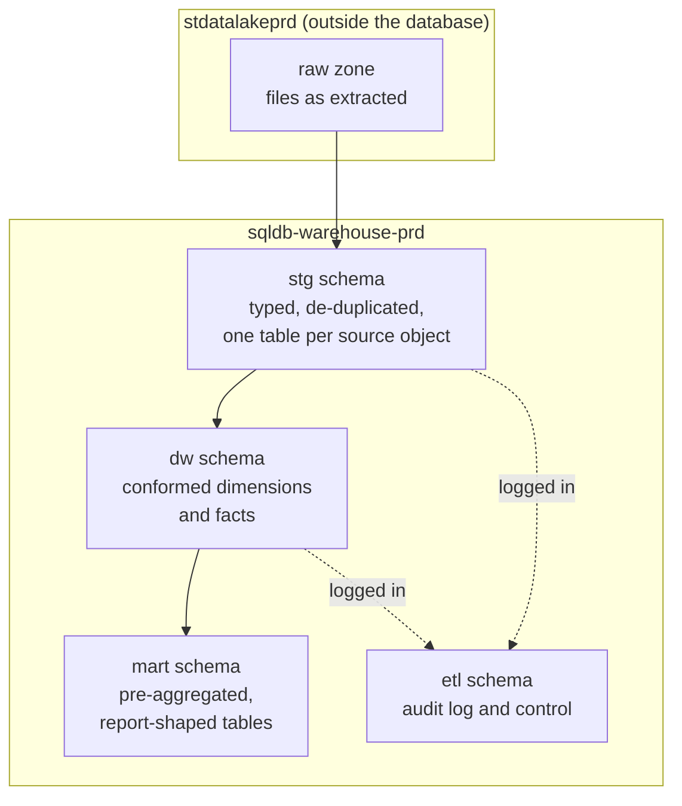

# Data Warehouse

The warehouse is a single Azure SQL database, [sqldb-warehouse-prd](../infrastructure/data-stores/sqldb-warehouse-prd.md "hosted-in"), organised into three schemas. Raw files never enter the database directly: they stay in the lake, and the [Load Warehouse](../pipelines/pl-load-warehouse.md "loaded-by") pipeline reads them into staging each night.

| Schema | Purpose | Rebuilt nightly? |
| --- | --- | --- |
| `stg` | Typed copy of the latest extract, with rejected rows flagged | Yes, truncated and reloaded |
| `dw` | Star schema with slowly changing dimensions | No, merged incrementally |
| `mart` | Aggregates for specific reports | Trailing 35 days |
| `etl` | Audit log and pipeline control tables | No, append-only |

## Dimensions

- [dw.dim_customer](./dim-customer.md "contains") — one row per customer version, combining CRM accounts and billing customers.
- [dw.dim_product](./dim-product.md "contains") — the billing product catalogue with category and plan attributes.

Dates use a conventional calendar table, `dw.dim_date`, generated once and extended yearly; it carries fiscal periods that begin in April.

## Facts

- [dw.fact_orders](./fact-orders.md "contains") — one row per invoiced or pending order line; the basis of revenue reporting.
- [dw.fact_subscription_events](./fact-subscription-events.md "contains") — one row per subscription lifecycle change; the basis of recurring revenue and churn.

## Marts and control

- [mart.sales_daily](./mart-sales-daily.md "contains") — daily sales by channel and category, read by the sales semantic model.
- [ETL Audit Log](./etl-audit-log.md "contains") — every pipeline step's start, finish, row counts and errors.

## Conventions

Surrogate keys are `int` identities named `<entity>_key`; business keys keep their source name. Every `dw` table carries `valid_from`, `valid_to` and `is_current` where history is kept, plus `etl_run_id` linking the row to the audit log. The original star schema was designed by [Brightwater Analytics](../infrastructure/vendors/brightwater-analytics.md "designed-by") and is now maintained by [Data Engineering](../teams/data-engineering.md "owned-by").

Tags: data warehouse, SQL, overview.
