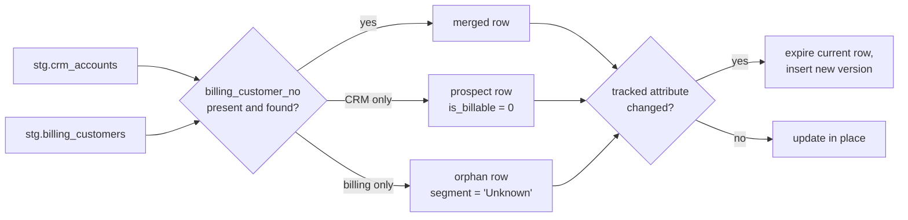

# dw.dim_customer

`dw.dim_customer` is the conformed customer dimension. It answers "who bought this?" for every fact table, and keeps history so that a customer's region or segment at the time of an order is preserved after they move.

## Sources and matching

Each customer exists in two places. [Relay CRM](../infrastructure/applications/relay-crm.md "reads-from") owns the account name, segment, region and marketing consent; [Ledgerline Billing](../infrastructure/applications/ledgerline-billing.md "reads-from") owns the billing customer number and payment terms. The CRM extract and billing extract both land in staging, and [Load Warehouse](../pipelines/pl-load-warehouse.md "loaded-by") matches them on the billing customer number stored on the CRM account.

Orphan billing customers are kept rather than dropped so that revenue always has a customer; the [Customer 360](../projects/customer-360.md "improved-by") project aims to eliminate them.

## Columns

| Column | Type | Notes |
| --- | --- | --- |
| `customer_key` | int | Surrogate key, one per version |
| `customer_id` | varchar(20) | Durable business key, `CUST-` prefix |
| `crm_account_id` | varchar(18) | Null for billing-only customers |
| `billing_customer_no` | varchar(12) | Null for prospects |
| `customer_name` | nvarchar(200) | From CRM, else billing |
| `segment` | varchar(20) | Consumer, Small Business or Enterprise |
| `region` | varchar(30) | Tracked: a change creates a new version |
| `marketing_consent` | bit | Not tracked; updated in place |
| `valid_from` / `valid_to` | datetime2 | Version window |
| `is_current` | bit | One current row per `customer_id` |

## Personal data

The dimension holds names but no contact details; email addresses and phone numbers stay in the CRM. Rows for erased customers are anonymised in place and keep their keys, so historical facts remain consistent.

Tags: dimension, customer, SCD2.
