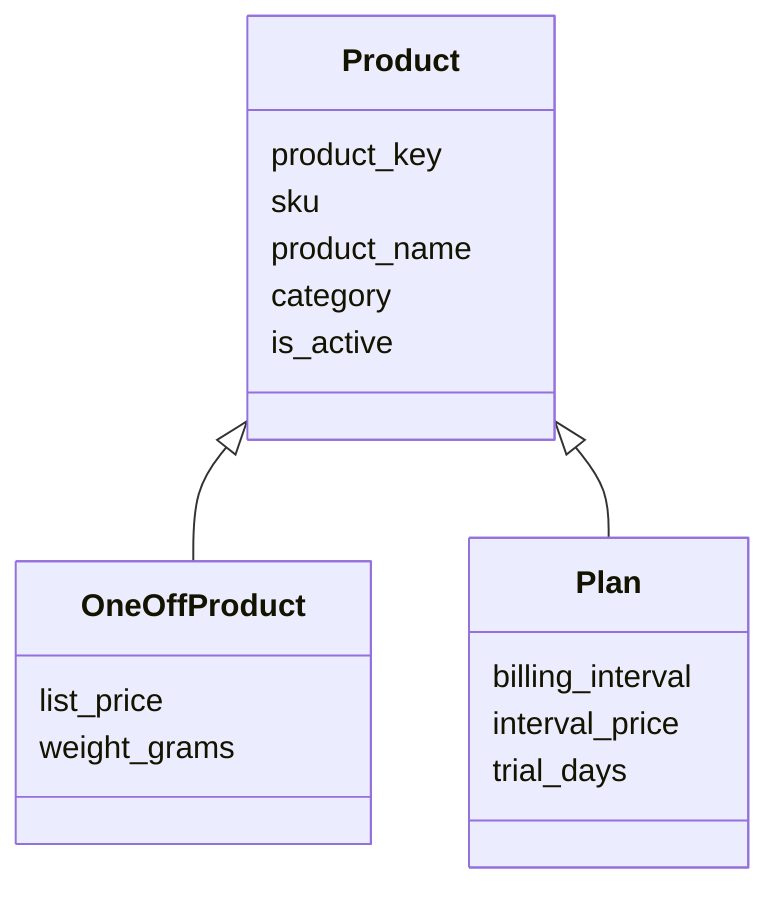

# dw.dim_product

`dw.dim_product` describes everything the company sells. It is built from the product catalogue in [Ledgerline Billing](../infrastructure/applications/ledgerline-billing.md "reads-from"), because billing is where prices and plans are defined; the portal only displays them.

Products come in two kinds. One-off products are shipped once and invoiced once. Plans are recurring subscriptions with a billing interval; their lifecycle is recorded in [dw.fact_subscription_events](./fact-subscription-events.md).

## Columns

| Column | Type | Notes |
| --- | --- | --- |
| `product_key` | int | Surrogate key |
| `sku` | varchar(30) | Business key from billing |
| `product_name` | nvarchar(200) | Display name |
| `product_kind` | varchar(10) | `one-off` or `plan` |
| `category` | varchar(40) | Merchandising category, mapped from billing groups |
| `billing_interval` | varchar(10) | `month` or `year` for plans, null otherwise |
| `list_price` | decimal(12,2) | Current list price excluding tax |
| `is_active` | bit | False once withdrawn from sale |

The dimension is type 1: price and category changes overwrite the current row. Historical prices are not needed here because each fact row records the actual price charged. Category mapping lives in a small seed table, `etl.category_map`, maintained by [Analytics and Reporting](../teams/analytics-and-reporting.md "curated-by") so that a new billing group never appears in reports as an unlabelled category.

Loaded by [Load Warehouse](../pipelines/pl-load-warehouse.md "loaded-by") before any fact table.

Tags: dimension, product, catalogue.
