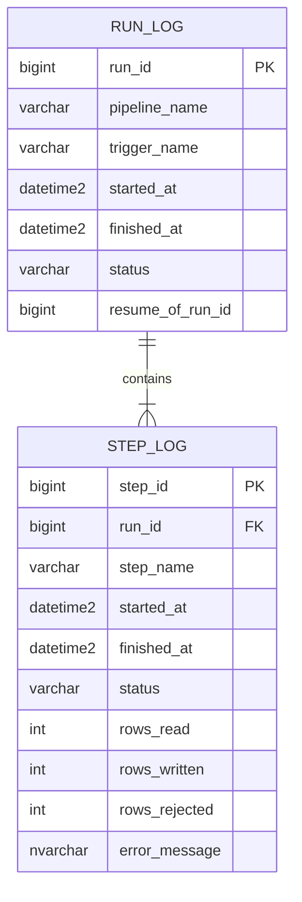
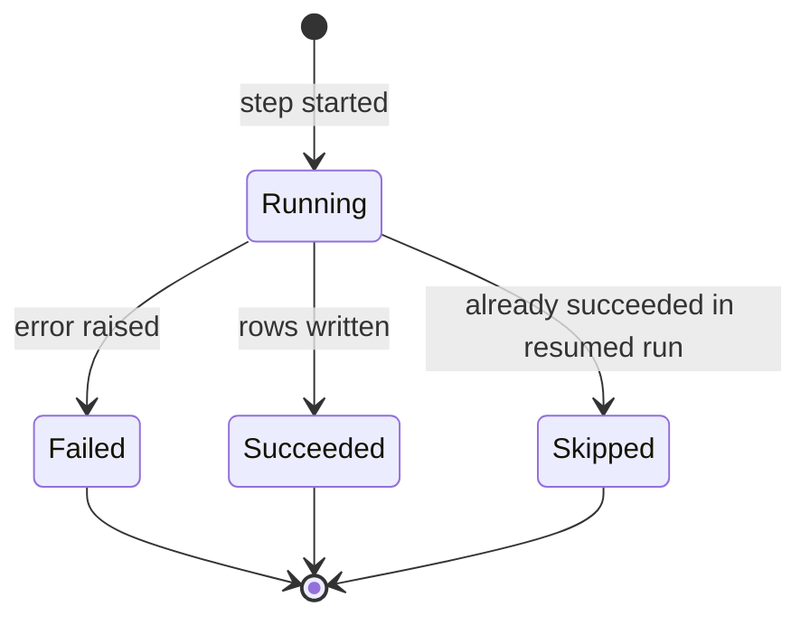

# ETL Audit Log

The audit log, `etl.run_log` and `etl.step_log`, is the platform's memory of what ran. Every pipeline writes a row when a step starts and updates it when the step finishes, so the log shows progress during a run and the full history afterwards. It is the first place to look when [troubleshooting a failed run](../guides/troubleshoot-failed-pipeline-runs.md "used-by").

## Structure

## Step status

A step left in `Running` after its run has ended means the factory stopped without reaching the step's failure path, usually because the self-hosted runtime was restarted mid-copy.

## Writers and readers

All pipelines under the [Master Nightly Pipeline](../pipelines/pl-master-nightly.md "written-by") log here, including [Extract CRM](../pipelines/pl-extract-crm.md "written-by"), [Extract Billing](../pipelines/pl-extract-billing.md "written-by") and [Load Warehouse](../pipelines/pl-load-warehouse.md "written-by"). The master pipeline reads it to decide which steps to skip when resuming a run. The morning sign-off in [Nightly Warehouse Refresh](../guides/nightly-warehouse-refresh.md) queries it directly.

Rows are never deleted. Runs older than two years are moved to `etl.run_log_archive` each January.

Tags: audit, ETL, monitoring.
