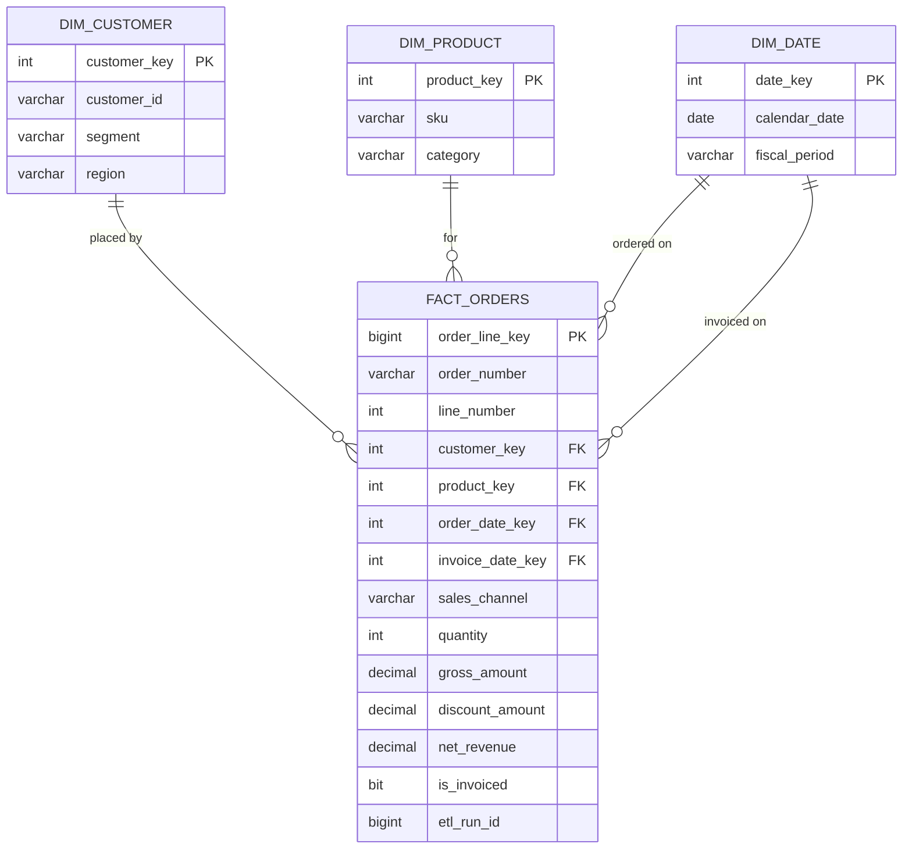

# dw.fact_orders

`dw.fact_orders` is the centre of sales reporting. Its grain is one row per order line: a portal order with three products produces three rows. Revenue comes from the matching invoice line in billing, not from the order, as explained in [Order Revenue Lineage](../guides/order-revenue-lineage.md "documented-by").

## Sources

Order lines arrive from the [Customer Portal](../infrastructure/applications/customer-portal.md "reads-from") as events in the lake; invoice lines arrive from [Ledgerline Billing](../infrastructure/applications/ledgerline-billing.md "reads-from") through the nightly extract. [Load Warehouse](../pipelines/pl-load-warehouse.md "loaded-by") joins the two on order number and line number. The customer key is resolved against [dw.dim_customer](./dim-customer.md "references") as at the order date, and the product key against [dw.dim_product](./dim-product.md "references").

## Measures

- `gross_amount` is quantity times the price charged, before discounts and excluding tax.
- `discount_amount` includes promotion codes and invoice-level credits allocated to lines by value.
- `net_revenue` is `gross_amount - discount_amount`. It is zero until the line is invoiced.

## Behaviour to know

Orders placed through the call centre are entered directly in billing and have no portal event; they appear with `sales_channel = 'Assisted'` and an order number generated by billing. Cancelled orders that were never invoiced are kept with `is_invoiced = 0` for funnel analysis. Credits issued after the month closes re-state the original line, which is why [mart.sales_daily](./mart-sales-daily.md) is rebuilt over a trailing window.

Tags: fact, orders, revenue.
