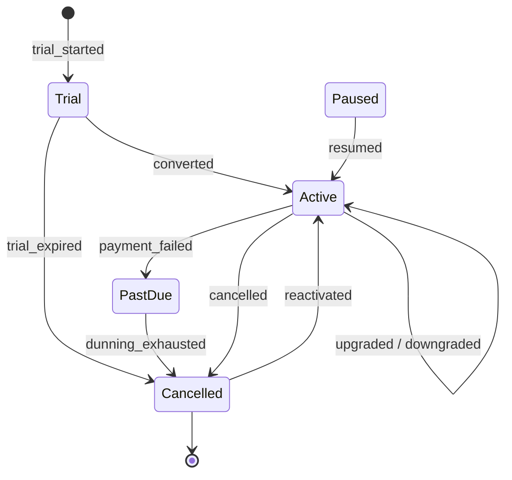

# dw.fact_subscription_events

`dw.fact_subscription_events` records how subscriptions change over time. Each row is one transition in a subscription's lifecycle, with the change in monthly recurring revenue (MRR) it caused. Summing `mrr_delta` up to any date gives the MRR at that date, which is how the [Finance Month-End Pack](../reporting/finance-month-end-pack.md) reports recurring revenue.

## Lifecycle

Subscriptions are created and changed only in [Ledgerline Billing](../infrastructure/applications/ledgerline-billing.md "reads-from"). The states and transitions below are the ones the warehouse recognises; any other billing status is mapped to the nearest state by [Load Warehouse](../pipelines/pl-load-warehouse.md "loaded-by").

## MRR movement

| Event                            | `mrr_delta`  | Counted as   |
| -------------------------------- | ------------ | ------------ |
| `converted`                      | + plan price | New MRR      |
| `upgraded`                       | + difference | Expansion    |
| `downgraded`                     | − difference | Contraction  |
| `paused`                         | − plan price | Contraction  |
| `cancelled`, `dunning_exhausted` | − plan price | Churn        |
| `reactivated`, `resumed`         | + plan price | Reactivation |

Annual plans contribute one twelfth of their price. Trials contribute nothing until converted, and `PastDue` keeps its MRR until dunning is exhausted.

## Keys

Each row references [dw.dim_customer](./dim-customer.md "references") as at the event, [dw.dim_product](./dim-product.md "references") for the plan after the event, and the event date. The business key is `subscription_id` plus `event_sequence`, which billing increments for every change.

## Known limitation

Billing records only the latest state of a subscription on the replica, so changes that happen and reverse within one day (for example an upgrade undone the same afternoon) are not seen. The [Warehouse Modernisation](../projects/warehouse-modernisation.md "affected-by") project plans to read billing's change feed instead.

Tags: fact, subscriptions, MRR, churn.
