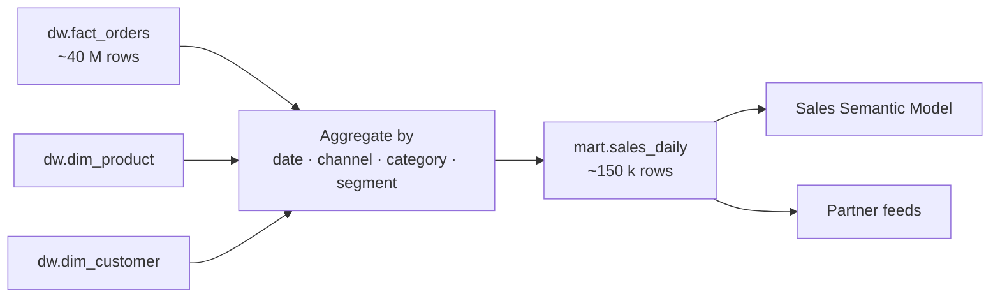

# mart.sales_daily

`mart.sales_daily` is a small, pre-aggregated table that makes sales reporting fast. It holds one row per day, sales channel, product category and customer segment, summarised from [dw.fact_orders](./fact-orders.md "reads-from") with category from [dw.dim_product](./dim-product.md "reads-from") and segment from [dw.dim_customer](./dim-customer.md "reads-from").

## Columns

| Column | Notes |
| --- | --- |
| `sales_date` | Invoice date for invoiced lines, order date otherwise |
| `sales_channel` | Portal, Mobile or Assisted |
| `category` | From `dim_product.category` |
| `segment` | From the customer version at order time |
| `orders` | Distinct order numbers |
| `units` | Sum of quantity |
| `gross_amount`, `discount_amount`, `net_revenue` | Sums from the fact |
| `pending_value` | Gross value of lines not yet invoiced |

## Refresh

[Load Warehouse](../pipelines/pl-load-warehouse.md "loaded-by") deletes and rebuilds the trailing 35 days every night, so late credits and late invoices re-state recent days. Older days are frozen; a full rebuild takes about twelve minutes and is run only after a fact correction.

## Consumers

The [Sales Semantic Model](../reporting/sales-semantic-model.md) imports the whole table. [Export Partner Feeds](../pipelines/pl-export-partner-feeds.md) reads the previous day's rows for the categories each partner is allowed to see.

Tags: mart, sales, aggregate.
