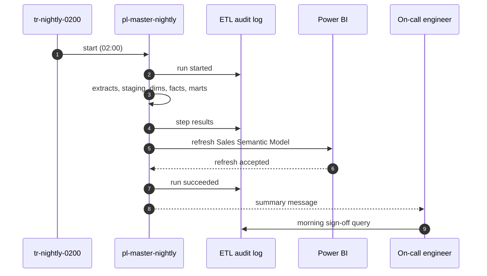

# Nightly Warehouse Refresh

The nightly refresh makes yesterday's orders, invoices and customer changes available in reporting by 07:00 local time. It is a single orchestrated run: the [tr-nightly-0200](../pipelines/tr-nightly-0200.md "scheduled-by") trigger starts the [Master Nightly Pipeline](../pipelines/pl-master-nightly.md "follows"), which runs the extracts in parallel, loads the warehouse, then refreshes reporting and partner exports.

## Typical timeline

Durations below are typical for a weekday; month-end and Mondays run longer because billing produces more invoices.

```mermaid
gantt
    title Typical weekday refresh (local time)
    dateFormat HH:mm
    axisFormat %H:%M
    section Extract
    Extract CRM            :crm, 02:00, 25m
    Extract billing        :bill, 02:00, 40m
    section Warehouse
    Load staging           :stg, after bill, 20m
    Load dimensions        :dims, after stg, 15m
    Load facts             :facts, after dims, 35m
    Build marts            :marts, after facts, 10m
    section Publish
    Refresh semantic model :pbi, after marts, 20m
    Export partner feeds   :feeds, after marts, 10m
    section Checks
    Morning sign-off       :milestone, 06:30, 0m
```

## Checkpoints

The run records each step in the [ETL Audit Log](../data-warehouse/etl-audit-log.md "reads-from"), so progress is visible without opening the factory. The sequence below shows who is told what during a normal night.

## Morning sign-off

Before 07:00 the on-call engineer from [Data Engineering](../teams/data-engineering.md "owned-by") confirms three things:

1. The latest run in the audit log is `Succeeded` and every step has a row count.
2. `mart.sales_daily` contains yesterday's date for every sales channel; see [mart.sales_daily](../data-warehouse/mart-sales-daily.md).
3. The [Sales Semantic Model](../reporting/sales-semantic-model.md) shows a refresh time after 05:00.

If any check fails, follow [Troubleshoot Failed Pipeline Runs](./troubleshoot-failed-pipeline-runs.md "escalates-to") and post a short notice in the analytics channel so that [Analytics and Reporting](../teams/analytics-and-reporting.md) can warn report users before the business day.

## Things that are not this runbook

The portal's real-time order events are not part of the nightly run; they land continuously through [func-order-events](../infrastructure/compute/func-order-events.md). The nightly run only reads what has already arrived in the lake.

Tags: runbook, ETL, operations, schedule.
