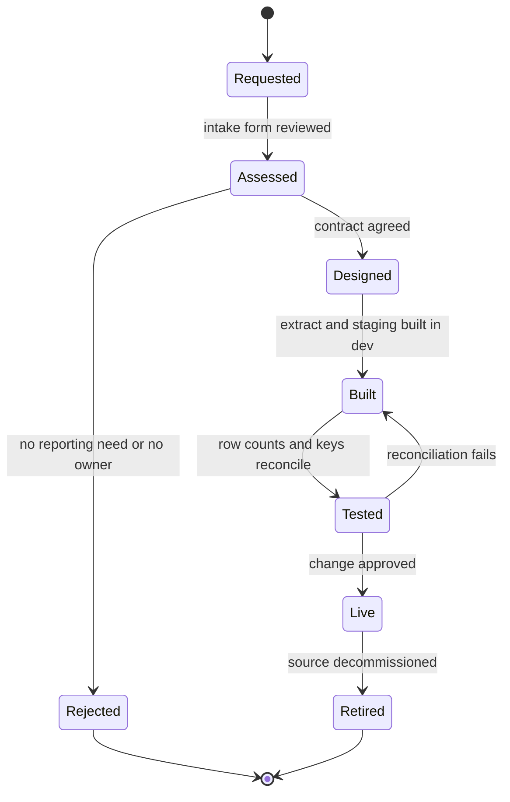

# Onboarding a Data Source

New sources are added through a short, repeatable process so that every extract has an owner, a documented contract and a predictable cost. The process is owned by [Data Engineering](../teams/data-engineering.md "owned-by") and typically takes two to four weeks.

## Stages

**Request and assess.** The requester names a business owner, the reports that need the data and how fresh it must be. Data Engineering confirms the source can be reached — over a public API, or privately through [vm-shir-01](../infrastructure/compute/vm-shir-01.md "uses") — and estimates the extra minutes it adds to the [Nightly Warehouse Refresh](./nightly-warehouse-refresh.md).

**Design the contract.** The contract records the objects to extract, their keys, how changes are detected (a modified timestamp, a change feed or a full snapshot) and any personal data. Personal data needs a retention decision before any build starts.

**Build.** Each source gets its own extract pipeline modelled on [Extract CRM](../pipelines/pl-extract-crm.md "template") for APIs or [Extract Billing](../pipelines/pl-extract-billing.md "template") for databases. It writes to its own `raw/<source>/` folder in [stdatalakeprd](../infrastructure/data-stores/stdatalakeprd.md "writes-to"), registers in the [ETL Audit Log](../data-warehouse/etl-audit-log.md), and is added as a branch of the [Master Nightly Pipeline](../pipelines/pl-master-nightly.md).

**Test and go live.** Row counts and key totals must reconcile against the source for three consecutive nights in development before the change is approved. Connection secrets are created in [kv-dataplatform-prd](../infrastructure/cloud/kv-dataplatform-prd.md "uses") by the platform team, never pasted into pipeline parameters.

## Artefacts checklist

- [ ] Source article in this library, linked from [Infrastructure](../infrastructure/infrastructure.md)
- [ ] Extract pipeline article describing its schedule, change detection and failure handling
- [ ] Lake folder and retention policy
- [ ] Audit log registration and alert routing
- [ ] Owner sign-off recorded in the change ticket

Tags: process, governance, ingestion.
