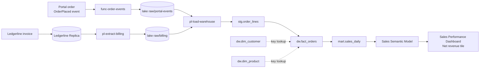

# Order Revenue Lineage

"Revenue" on the sales dashboard is net invoiced revenue, not the value of orders placed. This distinction explains most questions about why the dashboard differs from the portal's own order screen. This article traces one order through every hop.

## Hop by hop

1. **Order placed.** The [Customer Portal](../infrastructure/applications/customer-portal.md "traces") publishes an `OrderPlaced` event containing the order number, customer and lines. [func-order-events](../infrastructure/compute/func-order-events.md "traces") validates it and writes it to `raw/portal-events/` in [stdatalakeprd](../infrastructure/data-stores/stdatalakeprd.md "traces"). At this point the order has a value but no revenue.
2. **Invoiced.** When the order ships, [Ledgerline Billing](../infrastructure/applications/ledgerline-billing.md "traces") raises an invoice that references the portal order number. Discounts, credits and tax are applied here, so the invoice is the authority for revenue.
3. **Extracted.** [Extract Billing](../pipelines/pl-extract-billing.md "traces") copies new and changed invoice lines from the [Ledgerline Replica](../infrastructure/data-stores/ledgerline-replica.md) into `raw/billing/`.
4. **Joined and modelled.** [Load Warehouse](../pipelines/pl-load-warehouse.md "traces") matches invoice lines to portal events on order number, looks up [dw.dim_customer](../data-warehouse/dim-customer.md) and [dw.dim_product](../data-warehouse/dim-product.md), and writes one row per invoice line to [dw.fact_orders](../data-warehouse/fact-orders.md "traces"). Orders that have not yet been invoiced are kept with zero revenue and `is_invoiced = 0`.
5. **Aggregated.** [mart.sales_daily](../data-warehouse/mart-sales-daily.md "traces") sums net revenue by date, channel and product category.
6. **Reported.** The [Sales Semantic Model](../reporting/sales-semantic-model.md "traces") exposes `Net Revenue` over the mart, and the [Sales Performance Dashboard](../reporting/sales-performance-dashboard.md "traces") shows it as the headline tile.

## Why numbers differ

| Comparison | Expected difference |
| --- | --- |
| Portal order total vs dashboard revenue | Orders not yet shipped or invoiced; tax is excluded from revenue |
| Dashboard vs finance month-end pack | The finance pack uses the posting date, the dashboard uses the invoice date |
| Today's dashboard vs yesterday's | Late credits re-state earlier days, because the mart is rebuilt for the trailing 35 days |

The [Finance Month-End Pack](../reporting/finance-month-end-pack.md) is the authority for reported revenue; the dashboard is for trading decisions.

Tags: lineage, revenue, orders.
