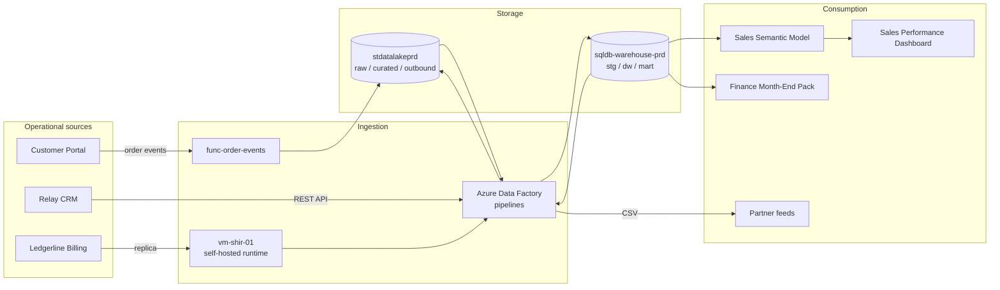

# Platform Landscape

The data platform turns three operational sources into trusted reporting. It is deliberately simple: one data lake, one warehouse database, one orchestrator and one reporting tool, all in a single Azure production subscription. This article gives the whole picture; each box links to a more detailed article.

## Sources

The [Customer Portal](../infrastructure/applications/customer-portal.md "describes") is the storefront and self-service site. Every order it accepts is published as an event to [func-order-events](../infrastructure/compute/func-order-events.md "describes"), which writes it to the lake within seconds. [Relay CRM](../infrastructure/applications/relay-crm.md "describes") holds accounts, contacts and marketing consent, and is read nightly through its REST API. [Ledgerline Billing](../infrastructure/applications/ledgerline-billing.md "describes") is the system of record for invoices and subscriptions; its vendor-provided [Ledgerline Replica](../infrastructure/data-stores/ledgerline-replica.md "describes") is reached through the [vm-shir-01](../infrastructure/compute/vm-shir-01.md) self-hosted integration runtime.

## Orchestration and storage

The [Data Factory Pipelines](../pipelines/pipelines.md "describes") run once a night under the [Master Nightly Pipeline](../pipelines/pl-master-nightly.md). Extracts land unchanged in the `raw` zone of [stdatalakeprd](../infrastructure/data-stores/stdatalakeprd.md "describes"); the warehouse load then reads from the lake and writes the [Data Warehouse](../data-warehouse/data-warehouse.md "describes") in [sqldb-warehouse-prd](../infrastructure/data-stores/sqldb-warehouse-prd.md). Keeping raw files in the lake means any warehouse table can be rebuilt without returning to a source system.

## Consumption

The [Sales Semantic Model](../reporting/sales-semantic-model.md "describes") is the single Power BI dataset for sales reporting and feeds the [Sales Performance Dashboard](../reporting/sales-performance-dashboard.md). Finance reads the warehouse directly for the [Finance Month-End Pack](../reporting/finance-month-end-pack.md). Trading partners receive daily files from [Export Partner Feeds](../pipelines/pl-export-partner-feeds.md).

## Where the platform is heading

The [Warehouse Modernisation](../projects/warehouse-modernisation.md) project is moving the transformation layer to a lakehouse pattern, and [Customer 360](../projects/customer-360.md) is unifying customer identity across the three sources. Neither changes the picture above yet; both articles describe the target state separately from what runs today.

Tags: architecture, overview, data flow.
