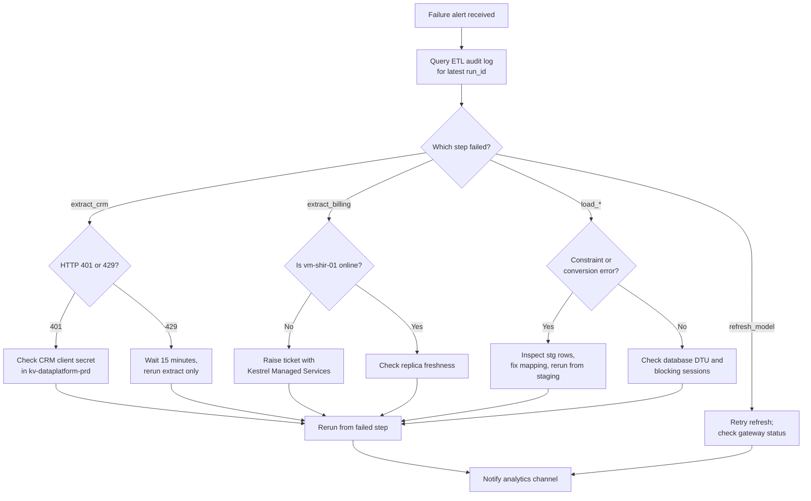

# Troubleshoot Failed Pipeline Runs

Most nightly failures fall into a handful of causes: a source that was unavailable, an expired connection secret, a self-hosted runtime that went offline, or data that broke a warehouse constraint. This guide gets from the alert to the cause quickly and explains which steps are safe to rerun.

## Find the failing step

Start in the [ETL Audit Log](../data-warehouse/etl-audit-log.md "reads-from") rather than the factory monitor: the log names the step, the batch and the error message, and it survives factory retention limits. Filter on the latest `run_id` and order by `started_at`.

## Common causes

**CRM authentication.** [Extract CRM](../pipelines/pl-extract-crm.md "diagnoses") authenticates with a client secret held in [kv-dataplatform-prd](../infrastructure/cloud/kv-dataplatform-prd.md "uses"). Relay CRM secrets expire every twelve months; an expiry shows as HTTP 401 on the first page request.

**Self-hosted runtime offline.** [Extract Billing](../pipelines/pl-extract-billing.md "diagnoses") can only reach the [Ledgerline Replica](../infrastructure/data-stores/ledgerline-replica.md) through [vm-shir-01](../infrastructure/compute/vm-shir-01.md "depends-on"). Monthly patching by [Kestrel Managed Services](../infrastructure/vendors/kestrel-managed-services.md "escalates-to") occasionally leaves the runtime service stopped.

**Bad source data.** [Load Warehouse](../pipelines/pl-load-warehouse.md "diagnoses") rejects rows that would break a key or a type conversion. Rejected rows stay in the `stg` schema with a reason code, so the dimension and fact tables are never half-loaded.

## Rerunning safely

Every extract writes to a dated folder in the lake and overwrites only that folder, so extracts are safe to rerun. The warehouse load is restartable from staging: pass the failed `run_id` as `resume_run_id` to the master pipeline and it skips steps already marked `Succeeded` in the audit log. Never truncate a `dw` table by hand; dimension history cannot be rebuilt from the latest extract alone.

When the rerun finishes, complete the sign-off in [Nightly Warehouse Refresh](./nightly-warehouse-refresh.md) and record the cause in the run's audit row.

Tags: troubleshooting, runbook, ETL.
