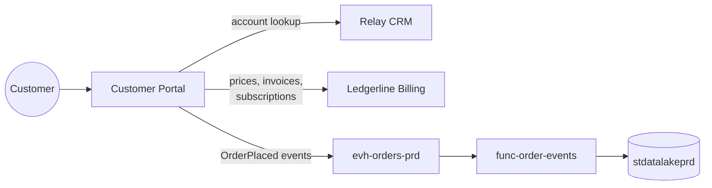
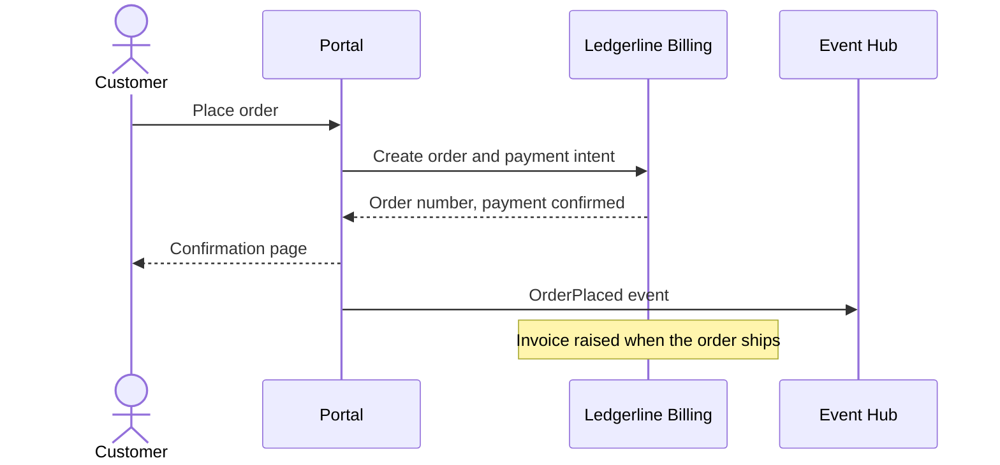

# Customer Portal

The Customer Portal is the website and mobile web experience where customers browse products, place orders, start subscriptions and manage their accounts. It is built and run by the digital product team on [aks-apps-prd](../compute/aks-apps-prd.md "hosted-in"). For the data platform it is a source of order events, not a database to extract.

## What it depends on

The portal reads customer accounts from [Relay CRM](./relay-crm.md "uses") and creates orders, invoices and subscriptions through the API of [Ledgerline Billing](./ledgerline-billing.md "uses"). It owns no customer master data of its own beyond sessions and baskets.

## Checkout sequence

The order number returned by billing is carried in the `OrderPlaced` event; it is the join key that lets [dw.fact_orders](../../data-warehouse/fact-orders.md "feeds") combine portal events with invoice lines. Events are delivered to the lake by [func-order-events](../compute/func-order-events.md).

## Channels

The portal serves two sales channels: `Portal` for desktop and `Mobile` for the mobile web layout. Orders taken by the call centre bypass the portal and are recorded as `Assisted` in the warehouse.

Tags: application, portal, e-commerce.
