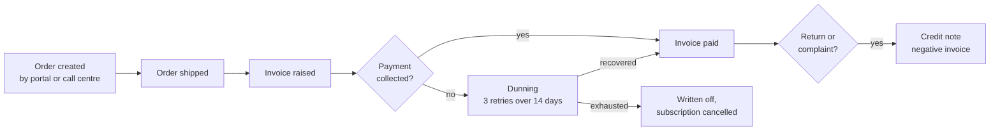

# Ledgerline Billing

Ledgerline Billing is the system of record for money: product prices, orders, invoices, credits, subscriptions and payment collection. It is a SaaS product from Ledgerline, used by finance and called by the [Customer Portal](./customer-portal.md "used-by") at checkout.

## Order-to-cash

Subscriptions generate an invoice on each renewal date through the same path. A credit note is stored as a negative invoice that references the original, which is why credits issued later re-state revenue in [dw.fact_orders](../../data-warehouse/fact-orders.md "feeds").

## How data leaves billing

Ledgerline does not permit reporting queries against its production database. Instead it ships transaction logs to the [Ledgerline Replica](../data-stores/ledgerline-replica.md "replicated-to"), which [Extract Billing](../../pipelines/pl-extract-billing.md) reads each night. Billing customer numbers are also pushed to [Relay CRM](./relay-crm.md "integrates-with") when a customer is first invoiced.

## What it feeds

- Revenue in [dw.fact_orders](../../data-warehouse/fact-orders.md).
- Subscription lifecycle in [dw.fact_subscription_events](../../data-warehouse/fact-subscription-events.md "feeds").
- The product catalogue in [dw.dim_product](../../data-warehouse/dim-product.md "feeds").
- Customer numbers and terms in [dw.dim_customer](../../data-warehouse/dim-customer.md).

Finance runs its month-end close in billing first; the [Finance Month-End Pack](../../reporting/finance-month-end-pack.md) is only produced once billing's period is locked.

Tags: application, billing, subscriptions.
