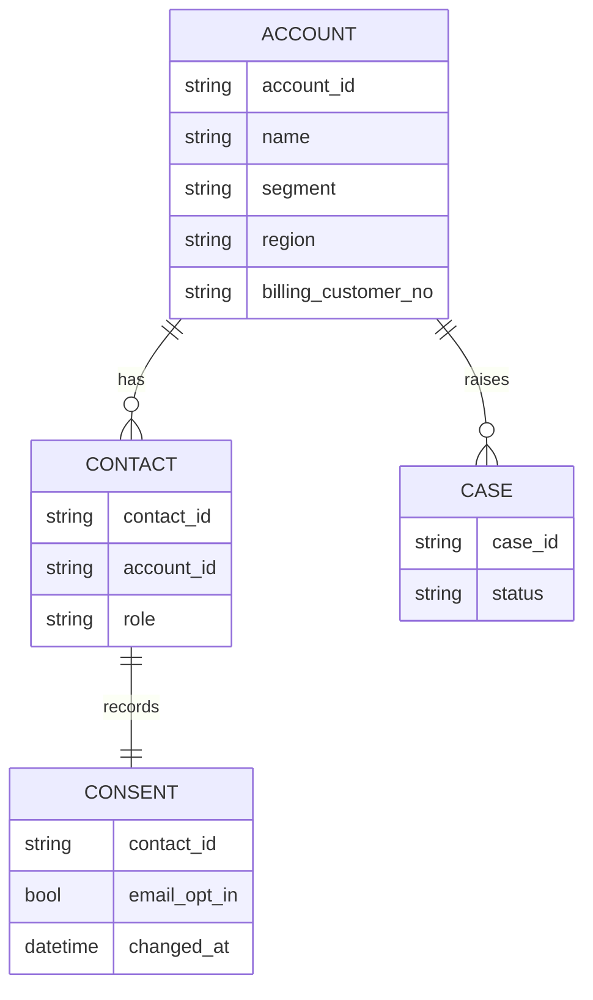

# Relay CRM

Relay CRM is the customer relationship management system used by sales, service and marketing. It is a multi-tenant SaaS product from Relay Software, administered by the sales operations team. It is the system of record for who a customer is: account names, contacts, segment, region and marketing consent.

## Data model in brief

The `billing_customer_no` field on the account is maintained by an integration from [Ledgerline Billing](./ledgerline-billing.md "synchronised-with") when a customer's first invoice is raised. It is the key that [dw.dim_customer](../../data-warehouse/dim-customer.md "feeds") uses to match CRM accounts to billing customers; accounts without it appear as prospects.

## Integrations

- The [Customer Portal](./customer-portal.md) looks up accounts in real time.
- [Extract CRM](../../pipelines/pl-extract-crm.md "read-by") pages through the REST API each night with a dedicated integration user.
- Service cases are not extracted; case reporting is done inside the CRM.

## Limits that matter

The API allows ten requests per second per client and 100,000 requests per day for the tenant, shared with the portal's lookups. Consent changes carry no queryable modification date, which is why the nightly extract takes a full consent snapshot.

The [Customer 360](../../projects/customer-360.md "subject-of") project is reviewing whether CRM or billing should be the master for customer addresses.

Tags: application, CRM, SaaS.
