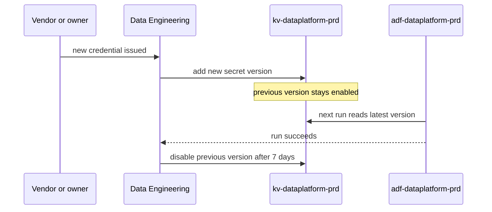

# kv-dataplatform-prd

`kv-dataplatform-prd` stores the few secrets the data platform still needs. Wherever a target supports Entra ID authentication, the factory uses its managed identity instead, so the vault holds only credentials for systems outside the tenant. It lives in [rg-dataplatform-prd](./rg-dataplatform-prd.md "hosted-in") behind a private endpoint, with public access disabled.

## Secrets

| Secret name | Used by | Rotation |
| --- | --- | --- |
| `crm-client-id`, `crm-client-secret` | [Extract CRM](../../pipelines/pl-extract-crm.md "used-by") | Every 12 months, set by Relay CRM |
| `ledgerline-replica-login` | [Extract Billing](../../pipelines/pl-extract-billing.md "used-by") | Every 90 days, on request to the vendor |
| `powerbi-refresh-sp-secret` | Master pipeline's model refresh | Every 6 months |
| `partner-sftp-host-key` | [Export Partner Feeds](../../pipelines/pl-export-partner-feeds.md "used-by") | When a partner changes its host |

The table records names and owners only. Values are never copied into articles, tickets or pipeline parameters.

## Rotation workflow

Expiry events are sent to the data engineering alert channel 30 days in advance. Rotation is the job of [Data Engineering](../../teams/data-engineering.md "owned-by"); the factory's managed identity has `Key Vault Secrets User`, which allows reading but not changing secrets.

Tags: security, secrets, Azure.
