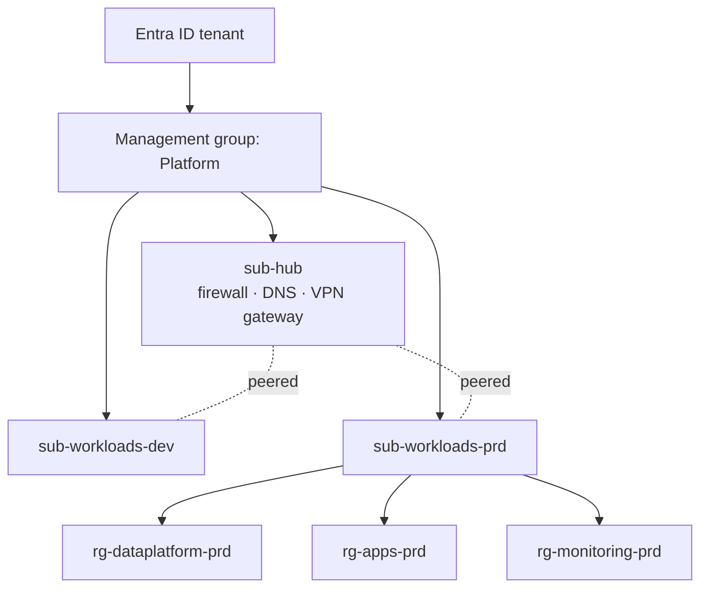

# Microsoft Azure

Azure is the primary cloud for both the customer-facing applications and the data platform. The estate follows a small landing-zone pattern: a hub subscription for shared networking and identity, and one subscription per environment for workloads.

## Production subscription

`sub-workloads-prd` contains the production resource groups. The data platform lives in [rg-dataplatform-prd](./rg-dataplatform-prd.md "contains"); the [Customer Portal](../applications/customer-portal.md "hosts") and its event function live in `rg-apps-prd`, on [aks-apps-prd](../compute/aks-apps-prd.md "contains") and [func-order-events](../compute/func-order-events.md "contains"). Logs from every resource flow to a shared Log Analytics workspace in `rg-monitoring-prd`.

## Conventions

| Convention | Rule |
| --- | --- |
| Naming | `<type>-<workload>-<env>`; storage accounts drop hyphens, e.g. `stdatalakeprd` |
| Regions | Primary region only; backups are geo-redundant |
| Access | Groups, never individuals, are assigned roles; production write access is just-in-time |
| Tags | `owner`, `cost-centre`, `environment` and `data-classification` are required |
| Network | Data services use private endpoints in the hub-peered workload network |

## Policy and cost

Azure Policy denies public network access on new storage accounts and SQL servers and requires the four tags. Monthly cost is reviewed per resource group; the data platform's largest costs are the warehouse database's nightly scale-up and lake storage transactions.

Platform engineering in the [Data Engineering](../../teams/data-engineering.md "administered-by") team manages the data platform's resource group; tenant-wide settings are outside this library.

Tags: Azure, cloud, landing zone.
