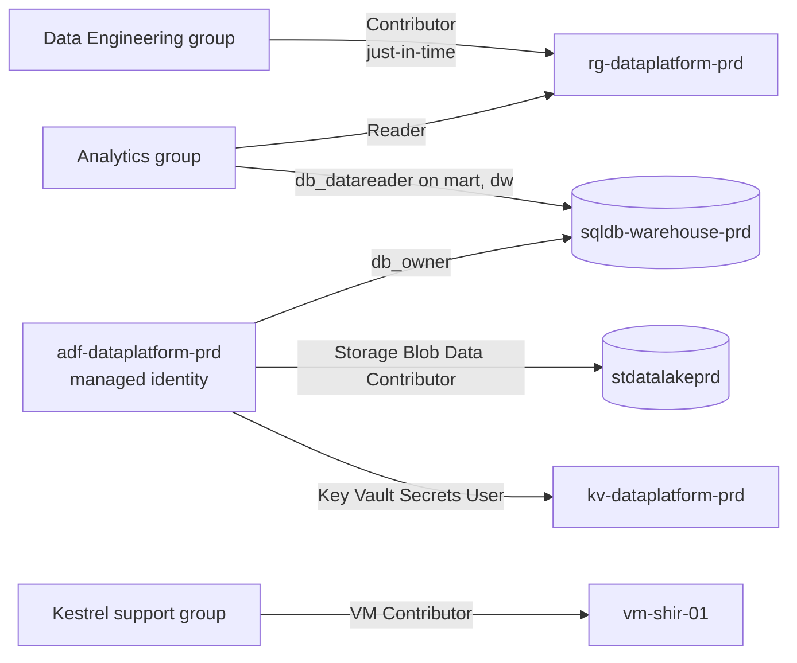

# rg-dataplatform-prd

`rg-dataplatform-prd` holds every production resource of the data platform, so that access, cost and policy can be managed as one unit. It sits in the production subscription of [Microsoft Azure](./microsoft-azure.md "part-of").

## Contents

| Resource | Type | Article |
| --- | --- | --- |
| `adf-dataplatform-prd` | Data factory | [Data Factory Pipelines](../../pipelines/pipelines.md "contains") |
| `sql-dataplatform-prd` / `sqldb-warehouse-prd` | Azure SQL server and database | [sqldb-warehouse-prd](../data-stores/sqldb-warehouse-prd.md "contains") |
| `stdatalakeprd` | Storage account, ADLS Gen2 | [stdatalakeprd](../data-stores/stdatalakeprd.md "contains") |
| `kv-dataplatform-prd` | Key vault | [kv-dataplatform-prd](./kv-dataplatform-prd.md "contains") |
| `vm-shir-01` | Virtual machine | [vm-shir-01](../compute/vm-shir-01.md "contains") |

Private endpoints for the database, lake and key vault are in the same group, attached to the workload network's data subnet.

## Access model

The factory's managed identity is the only principal that writes to the warehouse and lake during normal operation. [Data Engineering](../../teams/data-engineering.md "owned-by") holds standing Reader access and elevates to Contributor for releases. [Kestrel Managed Services](../vendors/kestrel-managed-services.md "managed-by") is scoped to the runtime virtual machine only.

## Cost

The group's monthly cost is dominated by the warehouse database (about 60 percent), followed by the virtual machine and lake storage. A budget alert at 110 percent of forecast notifies the owners.

Tags: Azure, resource group, production.
