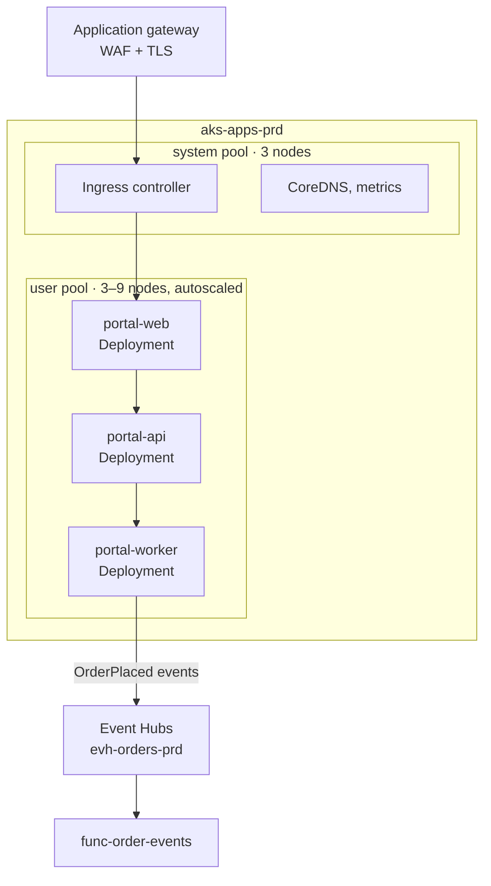

# aks-apps-prd

`aks-apps-prd` is the production Kubernetes cluster for customer-facing applications. Its main tenant is the [Customer Portal](../applications/customer-portal.md "runs"), and it lives in the production subscription of [Microsoft Azure](../cloud/microsoft-azure.md "hosted-in") in the `rg-apps-prd` resource group.

## Layout

## Workloads

| Workload | Replicas | Purpose |
| --- | --- | --- |
| `portal-web` | 3–12 | Server-rendered storefront |
| `portal-api` | 3–12 | Catalogue, basket, checkout and account APIs |
| `portal-worker` | 2 | Background jobs, including publishing order events |

The worker publishes each confirmed order to the `evh-orders-prd` event hub, from which [func-order-events](./func-order-events.md "feeds") lands it in the lake. The data platform has no access to the cluster itself; its only interface is that event stream.

## Operations

The cluster uses workload identity, so pods reach Azure services without stored secrets. Node images are upgraded weekly through a planned maintenance window on Tuesday mornings, and Kubernetes minor versions within 60 days of release. Deployments are made from the application team's pipelines; the data platform teams are informed of event schema changes through the [Customer 360](../../projects/customer-360.md) project's change log.

Tags: Kubernetes, AKS, compute.
