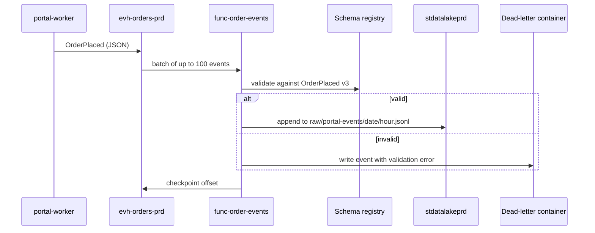

# func-order-events

`func-order-events` is a small Azure Functions app that turns the portal's order event stream into files in the lake. It runs on the Flex Consumption plan in the `rg-apps-prd` resource group of [Microsoft Azure](../cloud/microsoft-azure.md "hosted-in"), and is the only part of the data platform that runs continuously rather than nightly.

## Event flow

The function reads from the event hub fed by the [Customer Portal](../applications/customer-portal.md "reads-from") on [aks-apps-prd](./aks-apps-prd.md "reads-from"), and writes hourly JSON Lines files to `raw/portal-events/` in [stdatalakeprd](../data-stores/stdatalakeprd.md "writes-to") using its managed identity. Checkpointing happens only after the write, so a crash causes duplicates rather than gaps; the warehouse load de-duplicates on `event_id`.

## Event shape

| Field | Notes |
| --- | --- |
| `event_id` | UUID, unique per event |
| `event_type` | `OrderPlaced`, `OrderCancelled` |
| `schema_version` | Currently 3 |
| `order_number` | Matches the order number on the billing invoice |
| `customer_id` | Durable customer ID, `CUST-` prefix |
| `channel` | `Portal` or `Mobile` |
| `lines[]` | SKU, quantity and price charged |
| `occurred_at` | UTC timestamp |

## Monitoring

Alerts fire when no events arrive for 30 minutes during trading hours or when the dead-letter container receives more than ten events in an hour. Dead-lettered events are replayed after the schema mismatch is fixed. [Load Warehouse](../../pipelines/pl-load-warehouse.md) reads the files the following night to build [dw.fact_orders](../../data-warehouse/fact-orders.md).

Tags: Azure Functions, events, streaming.
