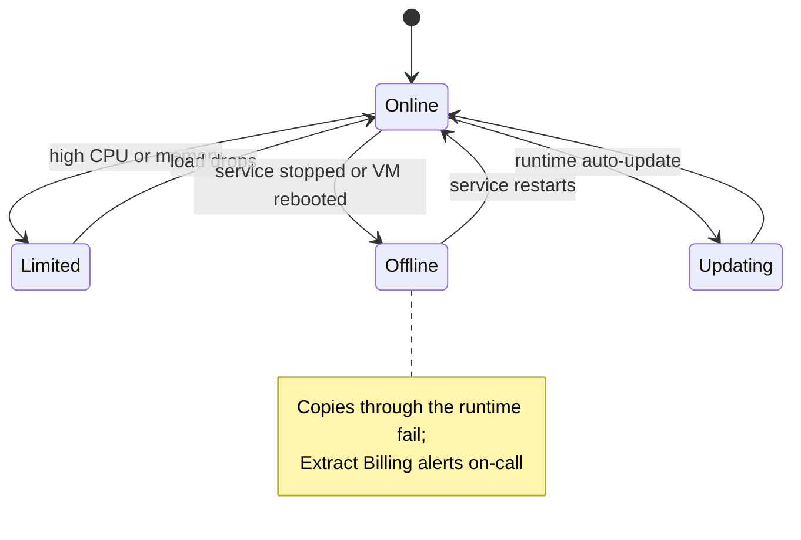

# vm-shir-01

`vm-shir-01` hosts the self-hosted integration runtime (SHIR) registered to the production data factory as `ir-selfhosted-prd`. It exists for one reason: the [Ledgerline Replica](../data-stores/ledgerline-replica.md "connects-to") can only be reached over the private VPN, which the Azure-hosted runtime cannot use. The VM sits in [rg-dataplatform-prd](../cloud/rg-dataplatform-prd.md "hosted-in") on the workload network's integration subnet.

## Specification

| Setting | Value |
| --- | --- |
| Size | 4 vCPU, 16 GB memory |
| Operating system | Windows Server 2022 Datacenter |
| Runtime | Self-hosted integration runtime, auto-update enabled |
| Concurrent jobs | 8 |
| Outbound | Factory control channel over HTTPS; replica over VPN on TCP 1433 |

## Runtime lifecycle

## Single point of failure

There is one node, so any outage stops [Extract Billing](../../pipelines/pl-extract-billing.md "used-by"). This was accepted because the extract tolerates a delayed start and the runtime restarts automatically after patching. A second node is part of the [Warehouse Modernisation](../../projects/warehouse-modernisation.md "addressed-by") backlog.

## Support

Operating system patching, antivirus and backup are provided by [Kestrel Managed Services](../vendors/kestrel-managed-services.md "managed-by") in a monthly window on the first Sunday from 01:00 to 01:45, finishing before [tr-nightly-0200](../../pipelines/tr-nightly-0200.md) fires. Runtime registration and its key are managed by [Data Engineering](../../teams/data-engineering.md "owned-by").

Tags: SHIR, virtual machine, integration runtime.
