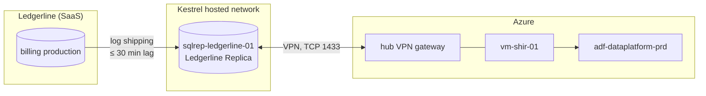

# Ledgerline Replica

The Ledgerline Replica is a read-only copy of the production database behind [Ledgerline Billing](../applications/ledgerline-billing.md "replica-of"). The billing vendor does not allow direct reporting queries against production, so it replicates the reporting tables to a SQL Server instance, `sqlrep-ledgerline-01`, that [Kestrel Managed Services](../vendors/kestrel-managed-services.md "hosted-by") runs in its hosted network.

## Network path

The replica has no public endpoint. The only route to it is a site-to-site VPN between Kestrel's network and the hub subscription, used by the self-hosted integration runtime.

## What it contains

Only the tables needed for reporting are replicated: invoice headers and lines, customers, subscriptions and the product catalogue. Payment instruments and card tokens are excluded at the source. Subscriptions are held in their latest state only, which is the root of the intra-day change limitation described in [dw.fact_subscription_events](../../data-warehouse/fact-subscription-events.md).

## Use

[Extract Billing](../../pipelines/pl-extract-billing.md "read-by") is the only consumer. It connects through [vm-shir-01](../compute/vm-shir-01.md "accessed-through") with a read-only login held in the data platform key vault. Ad hoc queries by analysts are not permitted; if an analyst needs billing data that the warehouse lacks, it is added to the extract.

Replication health is monitored by Kestrel, who raise an incident when lag exceeds one hour.

Tags: database, billing, replica.
