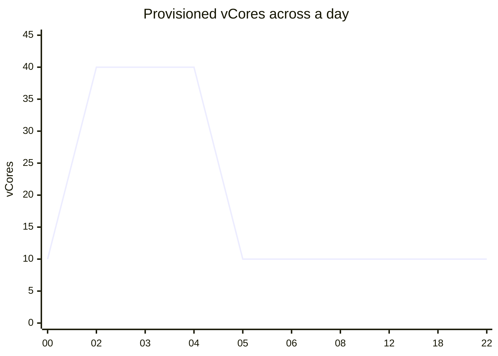

# sqldb-warehouse-prd

`sqldb-warehouse-prd` is the Azure SQL database that holds the [Data Warehouse](../../data-warehouse/data-warehouse.md "hosts"). It runs on the logical server `sql-dataplatform-prd` in [rg-dataplatform-prd](../cloud/rg-dataplatform-prd.md "hosted-in") and is reachable only through a private endpoint.

## Configuration

| Setting | Value |
| --- | --- |
| Service tier | General Purpose, provisioned |
| Compute | 10 vCores by day, 40 vCores during the nightly load |
| Storage | 1 TB maximum, about 380 GB used |
| Backups | Point-in-time restore for 14 days; weekly long-term backups kept for 1 year |
| Authentication | Entra ID only; SQL logins are disabled |

## Daily capacity pattern

[Load Warehouse](../../pipelines/pl-load-warehouse.md "written-by") scales the database up as its first step and down as its last. If a run fails before scaling down, the database stays at 40 vCores; the morning sign-off checks for this because it quadruples the hourly cost.

## Who connects

- The data factory's managed identity loads data and owns the schemas.
- The [Sales Semantic Model](../../reporting/sales-semantic-model.md "read-by") imports `mart` and `dw` tables through the on-premises data gateway cluster.
- The [Finance Month-End Pack](../../reporting/finance-month-end-pack.md "read-by") queries `dw` directly in DirectQuery mode.
- Analysts in [Analytics and Reporting](../../teams/analytics-and-reporting.md) have read access to `dw` and `mart`, never `stg`.

## Maintenance

Index and statistics maintenance runs on Sunday at 08:00. Major changes are deployed from the warehouse's database project; pause [tr-nightly-0200](../../pipelines/tr-nightly-0200.md) during any planned outage.

Tags: database, Azure SQL, data warehouse.
