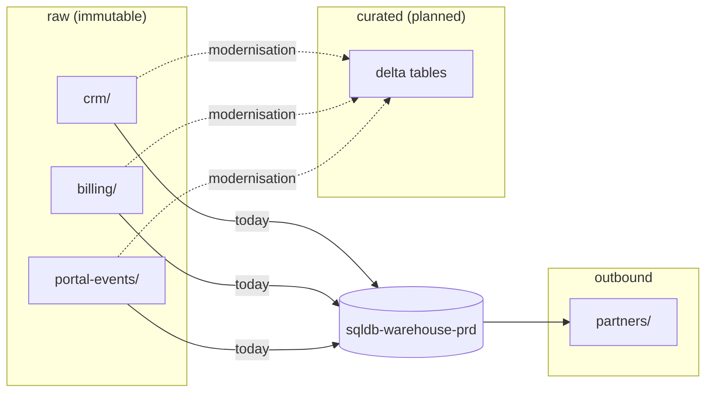

# stdatalakeprd

`stdatalakeprd` is the data lake: an Azure Data Lake Storage Gen2 account with a hierarchical namespace, in [rg-dataplatform-prd](../cloud/rg-dataplatform-prd.md "hosted-in"). It keeps every extract exactly as received, which lets the warehouse be rebuilt or corrected without going back to a source system.

## Zones

| Container | Written by | Retention |
| --- | --- | --- |
| `raw/crm/` | [Extract CRM](../../pipelines/pl-extract-crm.md "written-by") | 7 years, cool tier after 30 days |
| `raw/billing/` | [Extract Billing](../../pipelines/pl-extract-billing.md "written-by") | 7 years, cool tier after 30 days |
| `raw/portal-events/` | [func-order-events](../compute/func-order-events.md "written-by") | 7 years, cool tier after 30 days |
| `curated/` | Not yet in use | — |
| `outbound/partners/` | [Export Partner Feeds](../../pipelines/pl-export-partner-feeds.md "written-by") | 30 days |

Paths are partitioned by business date, for example `raw/billing/invoice_line/2026-10-12/`. Files in `raw` are never edited; a corrected extract is written to the same date folder and replaces the previous files whole.

The `curated` container is reserved for the delta tables planned by [Warehouse Modernisation](../../projects/warehouse-modernisation.md "planned-for"). It exists but holds no production data.

## Access

[Load Warehouse](../../pipelines/pl-load-warehouse.md "read-by") reads `raw` with the factory's managed identity. Partners reach only their own `outbound/partners/<partner>/` folder, through the account's SFTP endpoint with per-partner local users scoped to that folder. Soft delete is enabled for 14 days on all containers.

Tags: data lake, storage, ADLS.
