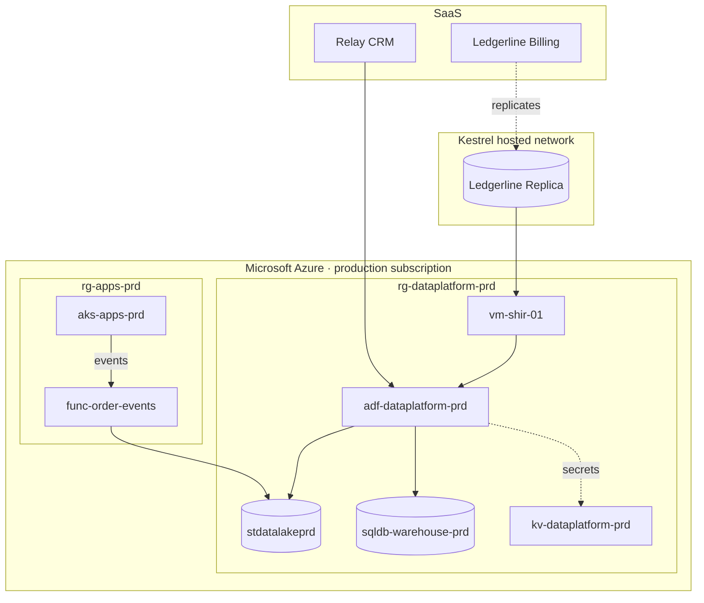

# Infrastructure

The data platform runs almost entirely in one Azure production subscription. The exceptions are the two SaaS source applications and the billing replica, which sits in a supplier's hosted network and is reached through a self-hosted integration runtime.

## Cloud

- [Microsoft Azure](./cloud/microsoft-azure.md "contains") — the subscription, landing zone and shared services.
- [rg-dataplatform-prd](./cloud/rg-dataplatform-prd.md "contains") — the resource group that holds every data platform resource.
- [kv-dataplatform-prd](./cloud/kv-dataplatform-prd.md "contains") — the key vault for connection secrets.

## Data stores

- [sqldb-warehouse-prd](./data-stores/sqldb-warehouse-prd.md "contains") — the Azure SQL warehouse database.
- [stdatalakeprd](./data-stores/stdatalakeprd.md "contains") — the ADLS Gen2 data lake.
- [Ledgerline Replica](./data-stores/ledgerline-replica.md "contains") — the vendor-hosted read replica of billing.

## Compute

- [vm-shir-01](./compute/vm-shir-01.md "contains") — the self-hosted integration runtime host.
- [aks-apps-prd](./compute/aks-apps-prd.md "contains") — the Kubernetes cluster that runs the customer portal.
- [func-order-events](./compute/func-order-events.md "contains") — the function app that lands portal order events.

## Applications

- [Customer Portal](./applications/customer-portal.md "contains") — the storefront and self-service site.
- [Relay CRM](./applications/relay-crm.md "contains") — the SaaS customer relationship system.
- [Ledgerline Billing](./applications/ledgerline-billing.md "contains") — the SaaS billing and subscription system.

## Suppliers

- [Brightwater Analytics](./vendors/brightwater-analytics.md "contains") — the consultancy that designed the warehouse.
- [Kestrel Managed Services](./vendors/kestrel-managed-services.md "contains") — the managed service provider for hosting and patching.

Tags: infrastructure, Azure, overview.
