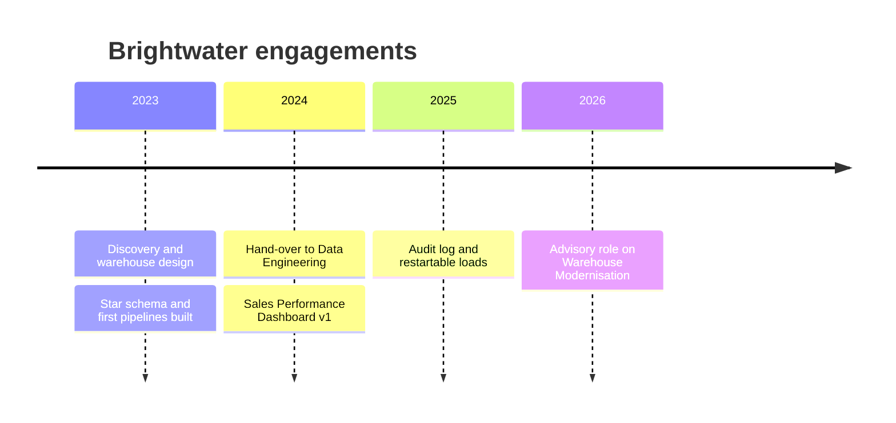

# Brightwater Analytics

Brightwater Analytics is a data consultancy that built the first version of the platform. Its engagement designed the star schema of the [Data Warehouse](../../data-warehouse/data-warehouse.md "designed"), the original [Data Factory Pipelines](../../pipelines/pipelines.md "built") and the first sales dashboards, and then handed operation to the internal [Data Engineering](../../teams/data-engineering.md "handed-over-to") team.

## Engagement history

## Current arrangement

Brightwater now works under a small annual time-and-materials agreement for specialist reviews. Its current work is advisory on [Warehouse Modernisation](../../projects/warehouse-modernisation.md "advises-on"), reviewing the lakehouse design and the migration plan for dimension history. It holds no standing access to production; when a review needs it, access is granted to a named consultant for the duration of the task and removed afterwards.

## What to expect from their artefacts

Older pipeline and stored procedure names follow Brightwater's conventions (`usp_` prefixes, `Load_` pipeline names). These were renamed during the 2025 refactor, but some comments and documents still use the old names. When an old document disagrees with this library, this library reflects the current configuration.

Tags: vendor, consultancy, data warehouse.
