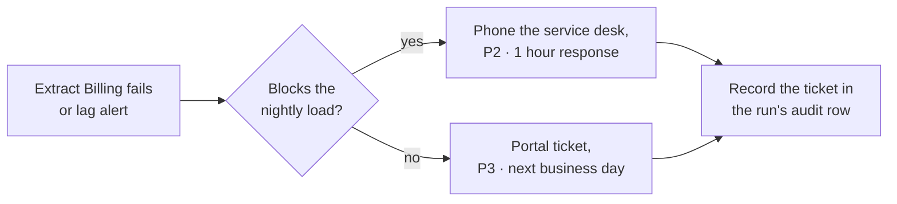

# Kestrel Managed Services

Kestrel Managed Services is a managed service provider with two responsibilities in the data platform. It hosts the [Ledgerline Replica](../data-stores/ledgerline-replica.md "hosts") in its own network on behalf of the billing vendor, and it provides operating-system support for [vm-shir-01](../compute/vm-shir-01.md "manages") in Azure.

## Responsibilities

| Area | Kestrel | Data Engineering |
| --- | --- | --- |
| Replica server, storage and replication | Owns | Reports issues |
| Site-to-site VPN, vendor side | Owns | Owns the Azure side |
| `vm-shir-01` operating system patching and backup | Owns | Approves windows |
| Integration runtime software and registration | — | Owns |
| Monitoring replication lag | Owns | Receives alerts |

## Raising an issue

The [Troubleshoot Failed Pipeline Runs](../../guides/troubleshoot-failed-pipeline-runs.md) guide decides when a failure is Kestrel's to fix. Kestrel's monthly patching window for the runtime host is agreed with [Data Engineering](../../teams/data-engineering.md "supports") so that it never overlaps the nightly load.

## Contract

The service agreement renews annually each July and is managed by the IT procurement team. Changes to the replica's table list are requested through Ledgerline, who instruct Kestrel; Kestrel does not change the replica on the data platform's request alone.

Tags: vendor, managed services, hosting.
