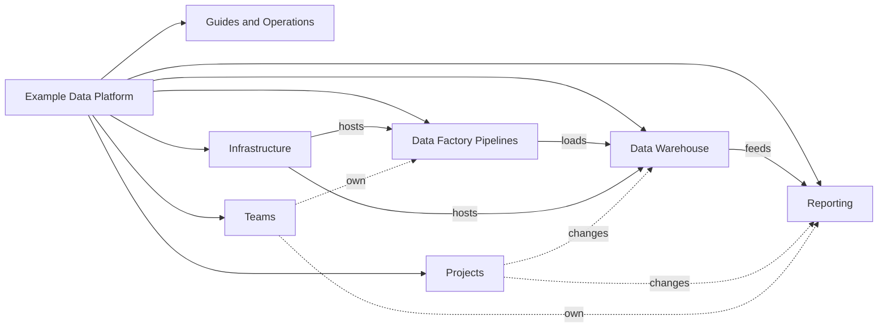

# Example Data Platform

This library documents the data platform of a fictional subscription retailer that sells physical products and recurring service plans through a customer portal. Customer relationships live in a SaaS CRM, invoices and subscriptions in a SaaS billing system, and the portal emits order events as they happen. A nightly set of Azure Data Factory pipelines lands all three in a data lake, models them into a dimensional warehouse and publishes the results to Power BI and to trading partners.

Every name, host, figure and organisation in this library is invented for demonstration. Use it to explore how Weave presents a connected workspace: follow links, open the graph, and compare the typed relationships shown in source mode.

## Explore the collections

- [Guides and Operations](./guides/guides.md "introduces") collects the platform landscape, the nightly runbook, troubleshooting steps and end-to-end lineage.
- [Data Warehouse](./data-warehouse/data-warehouse.md "introduces") describes the layered warehouse, its dimensions, facts, marts and audit log.
- [Data Factory Pipelines](./pipelines/pipelines.md "introduces") explains the orchestration that extracts, loads and exports data each night.
- [Infrastructure](./infrastructure/infrastructure.md "introduces") covers the Azure estate, data stores, compute, source applications and suppliers.
- [Reporting](./reporting/reporting.md "introduces") follows warehouse data into the semantic model, dashboards and the finance pack.
- [Projects](./projects/projects.md "introduces") records the change programmes that are reshaping the platform.
- The [Data Engineering](./teams/data-engineering.md) and [Analytics and Reporting](./teams/analytics-and-reporting.md) teams own the platform and its reports.

## Reading this library

Start with the [Platform Landscape](./guides/platform-landscape.md) for a single picture of how the pieces fit together, then follow a thread such as [Order Revenue Lineage](./guides/order-revenue-lineage.md) from a portal order to a dashboard tile. Typed links carry relationships such as `reads-from`, `writes-to`, `invokes` and `hosted-in`; they are hidden while reading and visible in source mode and on graph edges.

Tags: overview, data platform, knowledge.
