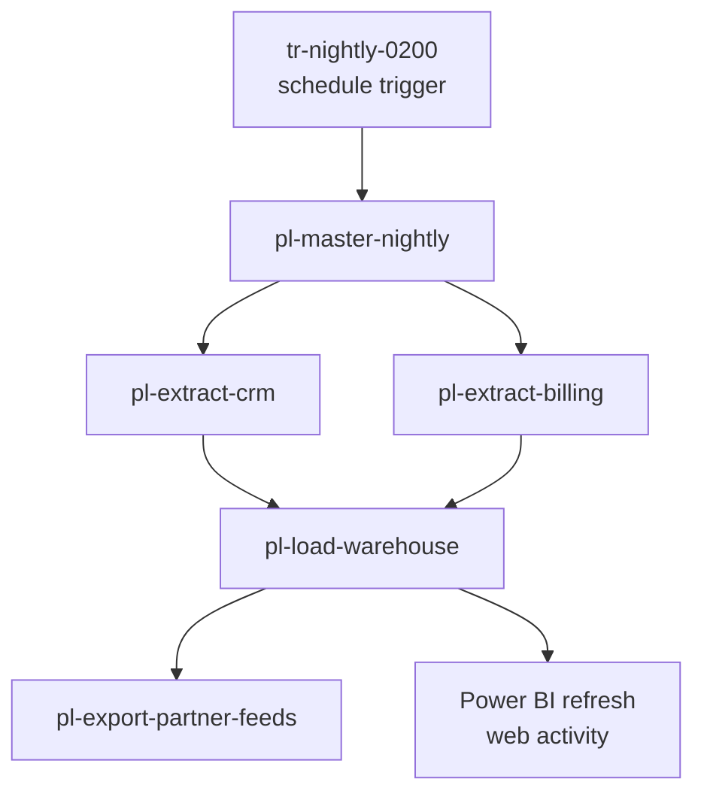

# Data Factory Pipelines

All scheduled data movement runs in one Azure Data Factory, `adf-dataplatform-prd`, deployed in [rg-dataplatform-prd](../infrastructure/cloud/rg-dataplatform-prd.md "hosted-in"). Pipelines are developed in a development factory, committed to Git, and released to production through a reviewed deployment; nobody edits the production factory directly.

## Pipeline hierarchy

| Pipeline | Role |
| --- | --- |
| [pl-master-nightly](./pl-master-nightly.md "contains") | Orchestrates the whole night, handles audit and failure paths |
| [pl-extract-crm](./pl-extract-crm.md "contains") | Pages through the Relay CRM API into the lake |
| [pl-extract-billing](./pl-extract-billing.md "contains") | Copies changed billing tables through the self-hosted runtime |
| [pl-load-warehouse](./pl-load-warehouse.md "contains") | Loads staging, dimensions, facts and marts |
| [pl-export-partner-feeds](./pl-export-partner-feeds.md "contains") | Writes daily partner CSV files to the lake's outbound zone |

The only schedule is [tr-nightly-0200](./tr-nightly-0200.md "contains"). Child pipelines have no triggers of their own, which keeps the run order in one place.

## Linked services

Linked services authenticate with the factory's managed identity wherever the target supports it — [stdatalakeprd](../infrastructure/data-stores/stdatalakeprd.md "uses") and [sqldb-warehouse-prd](../infrastructure/data-stores/sqldb-warehouse-prd.md "uses") both do. The CRM client secret and the replica's database login are read at run time from [kv-dataplatform-prd](../infrastructure/cloud/kv-dataplatform-prd.md "uses"). Copies to the billing replica run on the [vm-shir-01](../infrastructure/compute/vm-shir-01.md "uses") self-hosted integration runtime; everything else uses the Azure-hosted runtime.

## Ownership

[Data Engineering](../teams/data-engineering.md "owned-by") owns the factory and is paged when the master pipeline fails. The original pipelines were built by [Brightwater Analytics](../infrastructure/vendors/brightwater-analytics.md "built-by") and have since been refactored around the audit log.

Tags: ADF, orchestration, overview.
