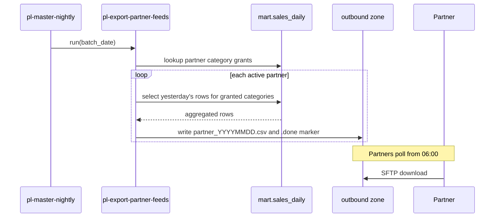

# Export Partner Feeds

`pl-export-partner-feeds` produces one CSV file per trading partner each night, containing the previous day's sales for the product categories that partner supplies. It reads [mart.sales_daily](../data-warehouse/mart-sales-daily.md "reads-from") and writes to the `outbound/partners/<partner>/` folders in [stdatalakeprd](../infrastructure/data-stores/stdatalakeprd.md "writes-to"), where each partner collects its file over SFTP.

## Contract

| Field | Notes |
| --- | --- |
| `sales_date` | ISO date |
| `category` | Only categories granted to the partner |
| `channel` | Portal, Mobile or Assisted |
| `units`, `net_revenue` | Rounded to whole units and two decimal places |

Files never contain customer-level data; the mart's segment column is aggregated away before writing. The `.done` marker file is written last so partners never read a partial file.

## Operations

The pipeline is invoked by the [Master Nightly Pipeline](./pl-master-nightly.md) after the warehouse load and can be skipped with `skip_partner_feeds`. Grants live in `etl.partner_grants` and are changed only through the [Partner Data Sharing](../projects/partner-data-sharing.md "governed-by") process, which also tracks the planned move from SFTP to direct data sharing.

Tags: pipeline, export, partners.
