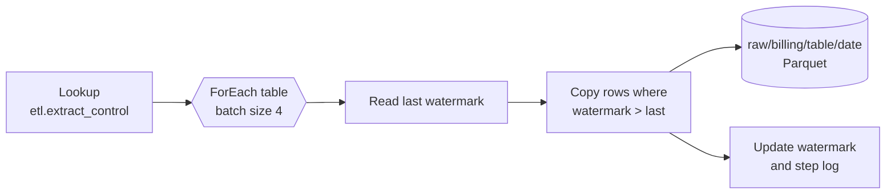

# Extract Billing

`pl-extract-billing` copies billing data from the [Ledgerline Replica](../infrastructure/data-stores/ledgerline-replica.md "reads-from") into `raw/billing/<table>/<batch_date>/` in [stdatalakeprd](../infrastructure/data-stores/stdatalakeprd.md "writes-to") as Parquet files. The replica is only reachable from inside the vendor's hosted network, so every copy runs on the [vm-shir-01](../infrastructure/compute/vm-shir-01.md "runs-on") self-hosted integration runtime.

## Table loop

The tables to copy are listed in `etl.extract_control` with their watermark column. A ForEach activity copies them four at a time.

| Table | Watermark | Notes |
| --- | --- | --- |
| `invoice_header` | `updated_at` | Includes credits as negative invoices |
| `invoice_line` | `updated_at` | Carries the portal order number and line |
| `customer` | `updated_at` | Billing customer number and terms |
| `subscription` | `updated_at` | Latest state only; see limitation below |
| `product` | full copy | Small catalogue, about 1,200 rows |

## Behaviour and limits

Watermarks are only advanced after the file is written, so a failed copy repeats the same window next time. The replica lags production billing by up to 30 minutes and is refreshed by the vendor; the 02:00 start time leaves ample margin.

Because the replica holds only each subscription's current row, intra-day changes are invisible to this extract. [dw.fact_subscription_events](../data-warehouse/fact-subscription-events.md) documents the effect, and the [Warehouse Modernisation](../projects/warehouse-modernisation.md "replaced-by") project will replace this table with the billing change feed.

The replica login is held in [kv-dataplatform-prd](../infrastructure/cloud/kv-dataplatform-prd.md "uses"). Runtime availability depends on [Kestrel Managed Services](../infrastructure/vendors/kestrel-managed-services.md "depends-on"), who patch the runtime host.

Tags: pipeline, extract, billing, SHIR.
