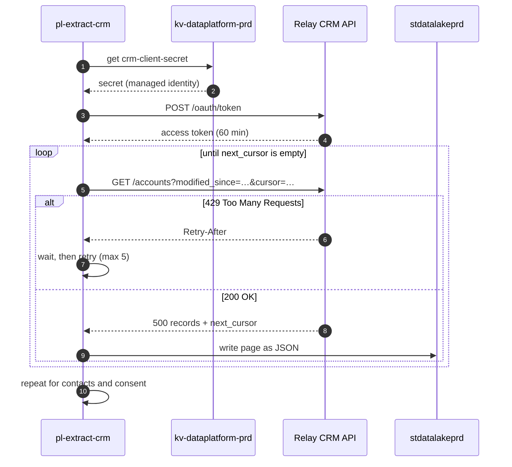

# Extract CRM

`pl-extract-crm` copies changed accounts, contacts and consent records from [Relay CRM](../infrastructure/applications/relay-crm.md "reads-from") into `raw/crm/<object>/<batch_date>/` in [stdatalakeprd](../infrastructure/data-stores/stdatalakeprd.md "writes-to"). It is invoked by the [Master Nightly Pipeline](./pl-master-nightly.md) and runs on the Azure-hosted integration runtime because the CRM API is public.

## How a page is fetched

The API returns at most 500 records per page and limits each client to ten requests per second. The pipeline asks only for records modified since the last successful extract, read from the [ETL Audit Log](../data-warehouse/etl-audit-log.md "reads-from").

The client secret comes from [kv-dataplatform-prd](../infrastructure/cloud/kv-dataplatform-prd.md "uses") at run time and is never stored in the factory.

## Objects extracted

| Object | Change detection | Typical nightly volume |
| --- | --- | --- |
| Accounts | `modified_at` | 1–3 k |
| Contacts | `modified_at` | 2–6 k |
| Consent | full snapshot | 180 k |

Consent is a full snapshot because the API does not expose consent change dates; it is small enough that this costs under two minutes.

## Downstream

The files are read by [Load Warehouse](./pl-load-warehouse.md) into `stg.crm_accounts` and `stg.crm_contacts`, which feed [dw.dim_customer](../data-warehouse/dim-customer.md). Contact details are used only for matching and are not carried into the warehouse.

Tags: pipeline, extract, API, CRM.
