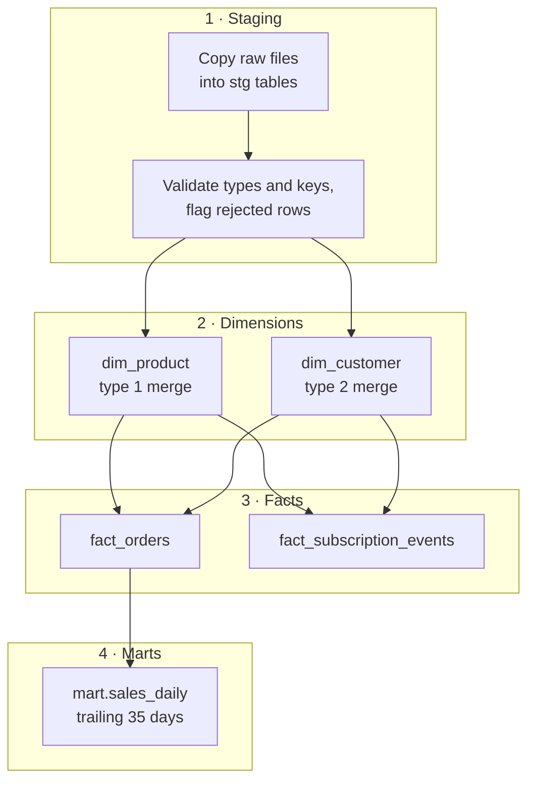

# Load Warehouse

`pl-load-warehouse` turns the night's raw files into reporting tables. It reads from [stdatalakeprd](../infrastructure/data-stores/stdatalakeprd.md "reads-from") and writes to [sqldb-warehouse-prd](../infrastructure/data-stores/sqldb-warehouse-prd.md "writes-to"), moving through four stages that each commit independently so a failure never leaves a half-loaded table.

## Stages

**Staging.** Each raw folder for `batch_date` is copied into its `stg` table, which is truncated first. A stored procedure checks types and business keys and marks failing rows with a reject reason instead of failing the step; the count appears as `rows_rejected` in the [ETL Audit Log](../data-warehouse/etl-audit-log.md "writes-to").

**Dimensions.** [dw.dim_product](../data-warehouse/dim-product.md "writes-to") is merged first, then [dw.dim_customer](../data-warehouse/dim-customer.md "writes-to"), which needs both CRM and billing staging tables.

**Facts.** [dw.fact_orders](../data-warehouse/fact-orders.md "writes-to") joins billing invoice lines to portal order events from `raw/portal-events/`; [dw.fact_subscription_events](../data-warehouse/fact-subscription-events.md "writes-to") compares each subscription's state with its last recorded state and inserts an event for every difference. The two fact loads run in parallel.

**Marts.** [mart.sales_daily](../data-warehouse/mart-sales-daily.md "writes-to") is rebuilt for the trailing 35 days.

## Performance

The database is scaled up from 10 to 40 vCores at the start of the load and back down when it finishes, through a scale activity that calls the Azure management API with the factory's managed identity. The facts stage dominates the run; see the timeline in [Nightly Warehouse Refresh](../guides/nightly-warehouse-refresh.md).

## Upstream and downstream

The load runs after [Extract CRM](./pl-extract-crm.md "depends-on") and [Extract Billing](./pl-extract-billing.md "depends-on") succeed. Portal events need no extract: they are already in the lake, written by [func-order-events](../infrastructure/compute/func-order-events.md "depends-on").

Tags: pipeline, load, data warehouse.
