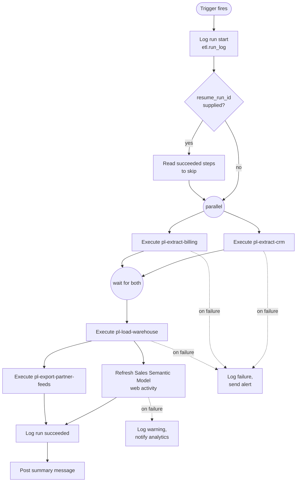

# Master Nightly Pipeline

`pl-master-nightly` is the single entry point for the overnight refresh. It owns ordering, audit logging and failure notification; the child pipelines it calls only move and transform data. [tr-nightly-0200](./tr-nightly-0200.md) starts it every day.

## Activity flow

## Child pipelines

1. [Extract CRM](./pl-extract-crm.md "invokes") and [Extract Billing](./pl-extract-billing.md "invokes") run in parallel. The load waits for both; if one fails the load does not start, so the warehouse is never refreshed from half the sources.
2. [Load Warehouse](./pl-load-warehouse.md "invokes") runs once both extracts succeed.
3. After the load, a web activity asks Power BI to refresh the [Sales Semantic Model](../reporting/sales-semantic-model.md "triggers"), and [Export Partner Feeds](./pl-export-partner-feeds.md "invokes") runs alongside it. A failed model refresh is a warning rather than a run failure: the warehouse is correct, and the refresh can be retried by hand.

## Audit and resume

The pipeline writes the run row and passes `run_id` to every child, which write their own step rows to the [ETL Audit Log](../data-warehouse/etl-audit-log.md "writes-to"). When started with `resume_run_id`, it reads that run's step rows and skips any step already `Succeeded`, which is how [Troubleshoot Failed Pipeline Runs](../guides/troubleshoot-failed-pipeline-runs.md) reruns a night without repeating the extracts.

## Parameters

| Parameter | Default | Purpose |
| --- | --- | --- |
| `batch_date` | yesterday, local time | Business date being loaded |
| `resume_run_id` | empty | Run to resume from |
| `skip_partner_feeds` | `false` | Set during partner outages |

Tags: pipeline, orchestration, ETL.
