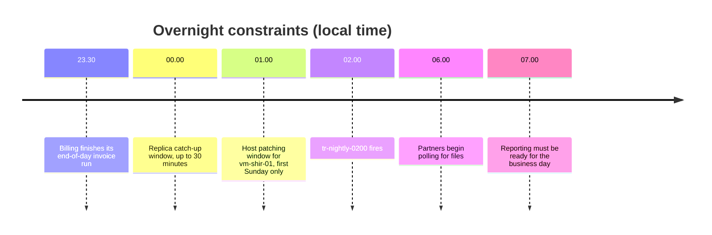

# tr-nightly-0200

`tr-nightly-0200` is the only schedule trigger in the production factory. It starts the [Master Nightly Pipeline](./pl-master-nightly.md "triggers") every day at 02:00 in the local time zone, with `batch_date` set to the previous calendar day.

## Why 02:00

The start time is a compromise between several overnight constraints:

Starting earlier risks reading the [Ledgerline Replica](../infrastructure/data-stores/ledgerline-replica.md "waits-for") before the end-of-day invoice run has replicated; starting later leaves too little slack before partners and report users need the data.

## Daylight saving

The trigger is defined in the local time zone rather than UTC, so it follows daylight saving changes. On the night clocks go forward, 02:00 does not exist and the run starts at 03:00; on the night they go back, the factory fires once, at the first 02:00.

## Changing the schedule

The trigger is deployed with the factory from Git, so a schedule change goes through the same review as a pipeline change. Pause it — rather than deleting it — during planned maintenance on [sqldb-warehouse-prd](../infrastructure/data-stores/sqldb-warehouse-prd.md), and note the pause in the run log so the morning sign-off in [Nightly Warehouse Refresh](../guides/nightly-warehouse-refresh.md) is not mistaken for a failure.

Tags: trigger, schedule, ADF.
