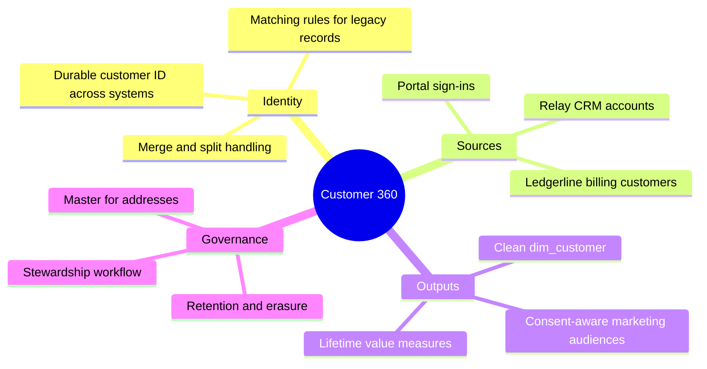

# Customer 360

Customer 360 aims to give every customer one identity across the CRM, billing and the portal, so that reporting can follow a customer from first contact to renewal. It is in discovery, led by [Analytics and Reporting](../teams/analytics-and-reporting.md "led-by") with a sponsor from marketing.

## The problem today

Customers are matched in [dw.dim_customer](../data-warehouse/dim-customer.md "changes") only through the billing customer number on the CRM account. Customers who were invoiced before the CRM integration existed, or who were created in billing by the call centre, have no CRM account and appear as orphans with an unknown segment. Roughly six percent of revenue currently sits with orphan customers.

## Scope

## Systems involved

- [Relay CRM](../infrastructure/applications/relay-crm.md "involves") — candidate master for name, segment and consent.
- [Ledgerline Billing](../infrastructure/applications/ledgerline-billing.md "involves") — master for billing customer number and terms.
- [Customer Portal](../infrastructure/applications/customer-portal.md "involves") — source of sign-in identity, already carrying the durable `CUST-` identifier in its order events.

## Open questions

1. Should the CRM or billing be the master for postal addresses?
2. Can the portal's durable identifier become the warehouse business key, replacing the current derived `customer_id`?
3. How are merged customers shown in historical reports: restated, or kept as they were at the time?

Findings will be recorded here before any change to [Load Warehouse](../pipelines/pl-load-warehouse.md). The project also keeps the change log of portal event schema changes that the data platform depends on.

Tags: project, customer, master data.
