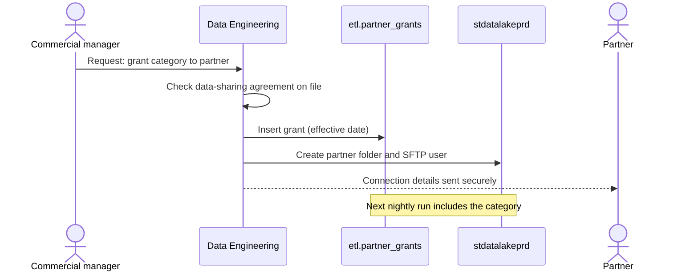

# Partner Data Sharing

Trading partners who supply products want to see how their categories sell. Partner Data Sharing provides that through a daily file per partner, produced by [Export Partner Feeds](../pipelines/pl-export-partner-feeds.md "delivers") from [mart.sales_daily](../data-warehouse/mart-sales-daily.md "uses"). Phase 1 is live; phase 2 is planned. The programme is run by [Data Engineering](../teams/data-engineering.md "led-by") with the commercial team as business owner.

## Governance

A partner receives only the categories it supplies, and never customer-level data. Grants are approved by the commercial team and recorded in `etl.partner_grants`.

Removing a grant follows the same path; the partner's earlier files remain available for 30 days.

## Phases

| Phase | Delivery | Status |
| --- | --- | --- |
| 1 | Daily CSV via SFTP from the `outbound` zone of [stdatalakeprd](../infrastructure/data-stores/stdatalakeprd.md "uses") | Live with four partners |
| 2 | Direct read-only sharing of a governed delta table, removing files | Planned after [Warehouse Modernisation](./warehouse-modernisation.md "depends-on") delivers gold tables |

## Measures of success

Partners download files on more than 95 percent of days, and no grant change takes longer than two working days. Partner questions about figures are answered from [Order Revenue Lineage](../guides/order-revenue-lineage.md), since partner files use the same net revenue definition as the sales dashboard.

Tags: project, partners, data sharing.
