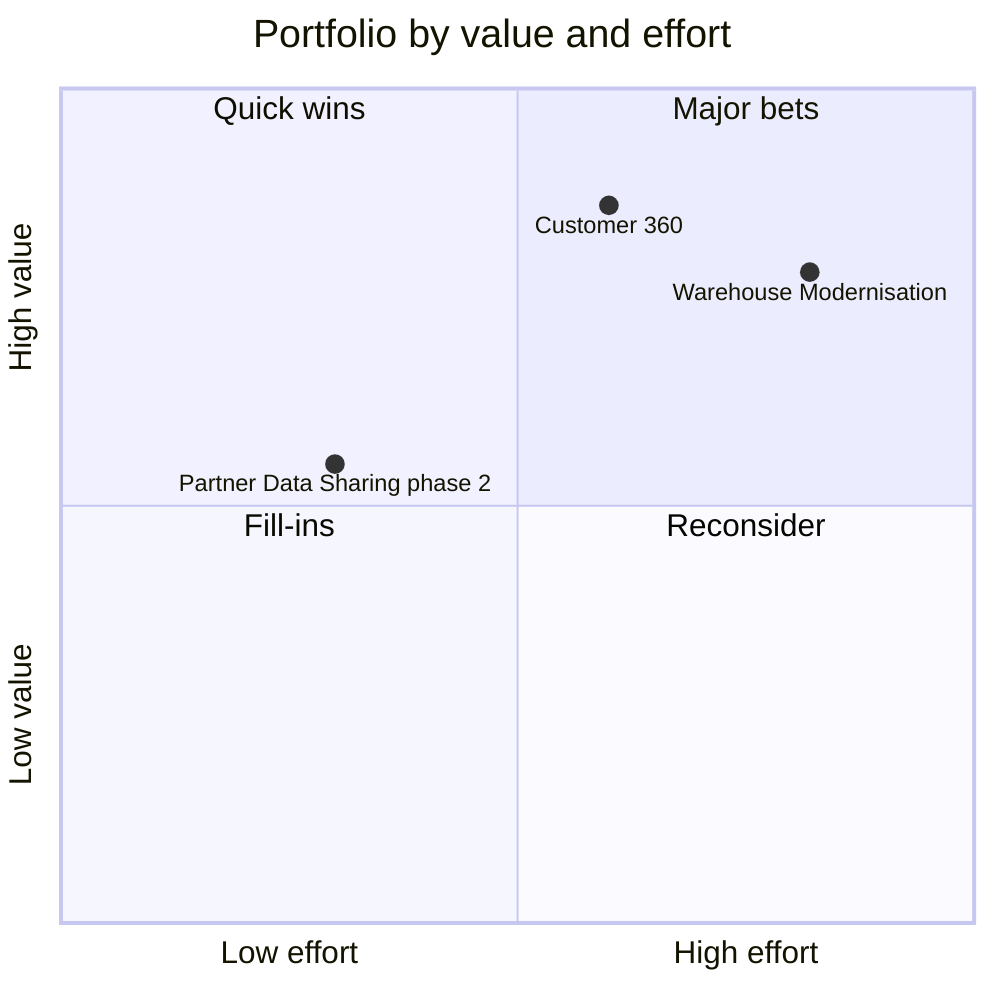

# Projects

Projects describe planned or in-flight change. Each project article separates what runs today from the target state, so readers can tell which statements describe production. When a project finishes, the articles for the systems it changed are updated and the project article records the outcome.

## Portfolio

| Project | Status | Lead team |
| --- | --- | --- |
| [Warehouse Modernisation](./warehouse-modernisation.md "contains") | In delivery | Data Engineering |
| [Customer 360](./customer-360.md "contains") | Discovery | Analytics and Reporting |
| [Partner Data Sharing](./partner-data-sharing.md "contains") | Live, phase 2 planned | Data Engineering |

## How projects are run

Each project has a business sponsor, a lead team and a short decision log kept in its article. Changes to production follow the same release process as day-to-day work; a project never gets a separate path to production. Architecture decisions that affect the whole platform are reviewed by both [Data Engineering](../teams/data-engineering.md) and [Analytics and Reporting](../teams/analytics-and-reporting.md).

Tags: projects, roadmap, overview.
