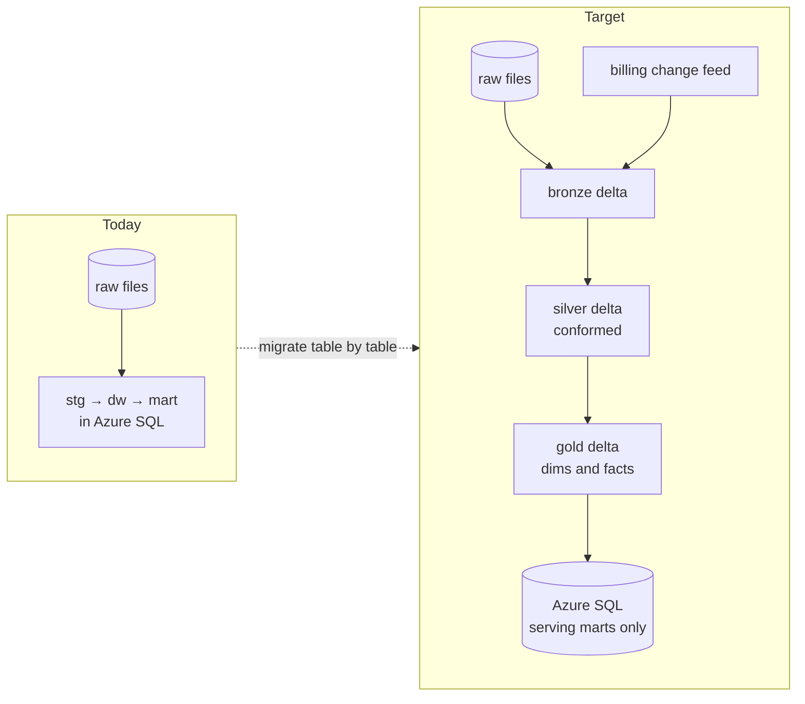
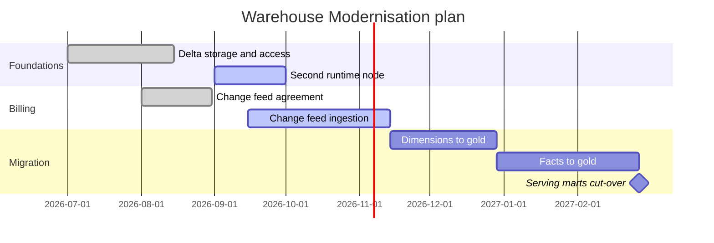

# Warehouse Modernisation

Warehouse Modernisation moves the platform from a nightly, database-centred load to a lakehouse pattern in which modelled data lives as delta tables in the lake and the SQL database serves only reporting. It is led by [Data Engineering](../teams/data-engineering.md "led-by"), with [Brightwater Analytics](../infrastructure/vendors/brightwater-analytics.md "advised-by") reviewing the design. Nothing described under "target state" runs in production yet.

## Why

- **Missed subscription changes.** [dw.fact_subscription_events](../data-warehouse/fact-subscription-events.md "changes") cannot see changes that reverse within a day, because [Extract Billing](../pipelines/pl-extract-billing.md "changes") reads only the latest state from the replica.
- **Single runtime node.** [vm-shir-01](../infrastructure/compute/vm-shir-01.md "changes") is a single point of failure for billing data.
- **Cost.** Scaling [sqldb-warehouse-prd](../infrastructure/data-stores/sqldb-warehouse-prd.md "changes") to 40 vCores every night is the platform's largest cost.

## Target state

Modelled tables move to the `curated` container of [stdatalakeprd](../infrastructure/data-stores/stdatalakeprd.md "uses"), and [Load Warehouse](../pipelines/pl-load-warehouse.md "replaces") is split into a lake transformation step and a small serving load.

## Plan

## Decisions

| Date | Decision |
| --- | --- |
| 2026-07 | Keep Azure SQL for serving so Power BI connections do not change |
| 2026-08 | Ledgerline to provide a change feed in place of the replica's subscription table |
| 2026-09 | Dimension history migrates as-is; no restatement of past versions |

## Risks

Dimension history in [dw.dim_customer](../data-warehouse/dim-customer.md) cannot be rebuilt from raw files alone, so it is migrated by copying rather than reprocessing. Report owners in [Analytics and Reporting](../teams/analytics-and-reporting.md) will validate each migrated table against the [Sales Semantic Model](../reporting/sales-semantic-model.md) before cut-over.

Tags: project, lakehouse, modernisation.
