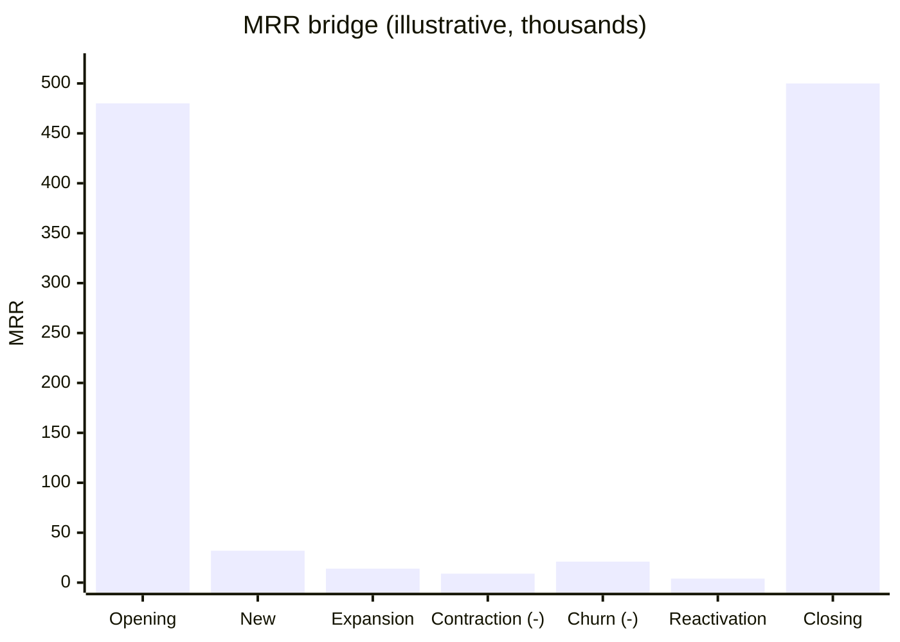
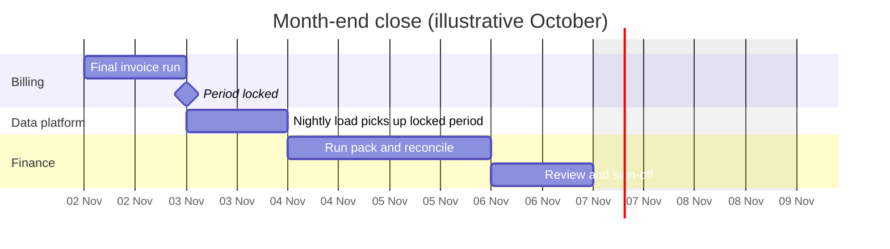

# Finance Month-End Pack

The Finance Month-End Pack is a set of paginated Power BI reports that finance prints, reviews and signs off at the close of each month. Unlike the sales dashboard it uses posting dates and locked periods, so its revenue is the reported figure for the month.

## Sections

1. **Revenue summary** — net revenue by category and channel from [dw.fact_orders](../data-warehouse/fact-orders.md "reads-from"), by posting period.
2. **Recurring revenue bridge** — opening MRR, new, expansion, contraction, churn and reactivation, closing MRR, from [dw.fact_subscription_events](../data-warehouse/fact-subscription-events.md "reads-from").
3. **Customer movements** — new, returning and lapsed customers by segment, using [dw.dim_customer](../data-warehouse/dim-customer.md "reads-from").
4. **Reconciliation** — warehouse totals beside billing's own period totals, with the difference highlighted.

## Recurring revenue bridge

The bridge is the pack's most-read page. Its shape is always the same:

Contraction and churn are shown as magnitudes; they are subtracted in the bridge, so opening plus new, expansion and reactivation, less contraction and churn, equals closing.

## Close calendar

The pack is only run after billing's period is locked in [Ledgerline Billing](../infrastructure/applications/ledgerline-billing.md "depends-on"), because invoices raised before the lock can still change.

## Connection

The pack queries [sqldb-warehouse-prd](../infrastructure/data-stores/sqldb-warehouse-prd.md "connects-to") in DirectQuery mode so that a reconciling correction loaded overnight appears without a separate refresh. It is maintained by [Analytics and Reporting](../teams/analytics-and-reporting.md "owned-by") with finance as the business owner.

Tags: finance, paginated report, MRR.
