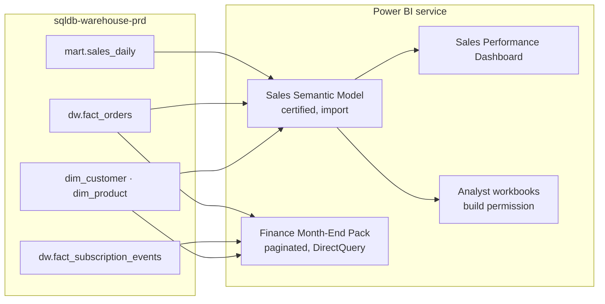

# Reporting

Reporting is built in Power BI on top of the [Data Warehouse](../data-warehouse/data-warehouse.md "reads-from"). The guiding rule is one certified semantic model per subject area, with many reports on top of it, so that a measure such as net revenue is defined once.

## Reports and models

- [Sales Semantic Model](./sales-semantic-model.md "contains") — the certified dataset for sales: revenue, orders, units and customers.
- [Sales Performance Dashboard](./sales-performance-dashboard.md "contains") — the daily trading view used by sales and marketing leads.
- [Finance Month-End Pack](./finance-month-end-pack.md "contains") — the paginated report pack finance signs off each month, including recurring revenue.

## Workspaces and access

| Workspace | Contents | Audience |
| --- | --- | --- |
| `Sales [Prod]` | Model and dashboard, published as an app | Sales, marketing, leadership |
| `Finance [Prod]` | Month-end pack | Finance only |
| `Analytics [Dev]` | Work in progress | Analysts |

Content moves from development to production through deployment pipelines, never by republishing from a desktop file. Row-level security limits regional managers to their own region.

## Ownership

[Analytics and Reporting](../teams/analytics-and-reporting.md "owned-by") owns the models and reports, and [Data Engineering](../teams/data-engineering.md) owns the warehouse tables they read. A change to a `dw` or `mart` column is agreed between the two teams before release, because a renamed column breaks a model refresh the following morning.

Tags: reporting, Power BI, overview.
