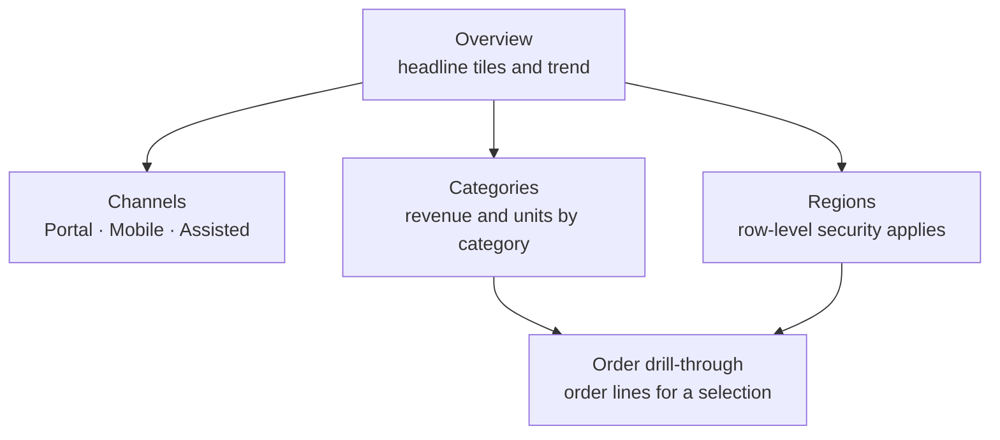
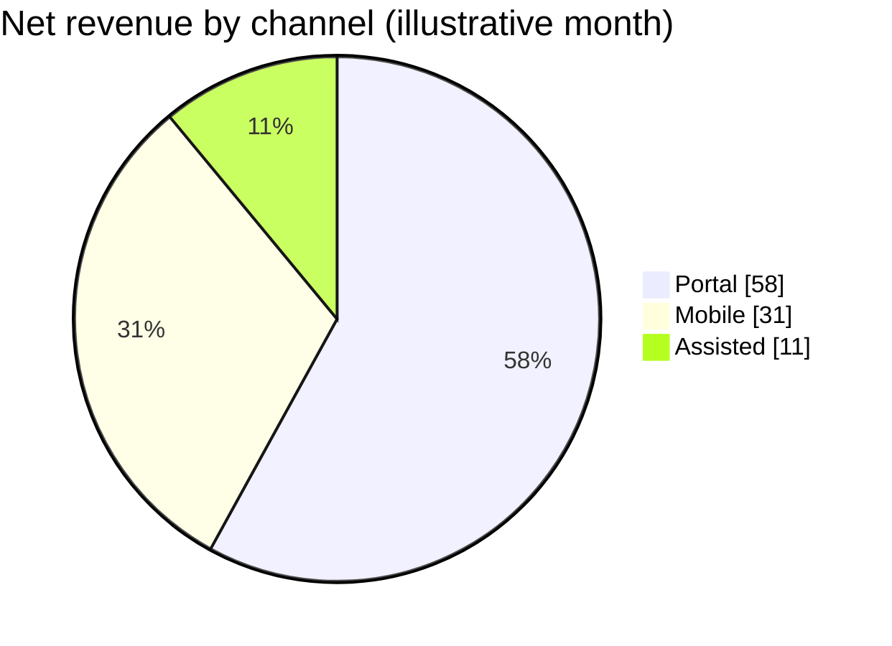

# Sales Performance Dashboard

The Sales Performance Dashboard is the trading view that sales and marketing leads open each morning. It shows yesterday's and month-to-date revenue, order counts and channel mix, compared with last year and with target. Every visual reads from the [Sales Semantic Model](./sales-semantic-model.md "reads-from"); the dashboard contains no measures of its own.

## Pages

## Typical channel mix

The channel page leads with a share-of-revenue chart. The figures below are illustrative of a normal month:

## Reading it correctly

- **Revenue means invoiced revenue.** A spike in orders shows in `Pending Value` first and moves into `Net Revenue` as orders ship; [Order Revenue Lineage](../guides/order-revenue-lineage.md "explained-by") explains why.
- **Recent days can change.** Credits re-state the trailing 35 days, so last week's figure may fall slightly.
- **Targets are monthly.** Daily targets are a straight-line split of the monthly target and ignore weekday seasonality.

## Freshness

A banner at the top shows the model's last refresh time. If it is earlier than today's 05:00, the nightly run has not finished; the [Nightly Warehouse Refresh](../guides/nightly-warehouse-refresh.md) runbook describes what the on-call engineer is checking.

The dashboard is published in the `Sales [Prod]` app and owned by [Analytics and Reporting](../teams/analytics-and-reporting.md "owned-by").

Tags: dashboard, Power BI, sales.
