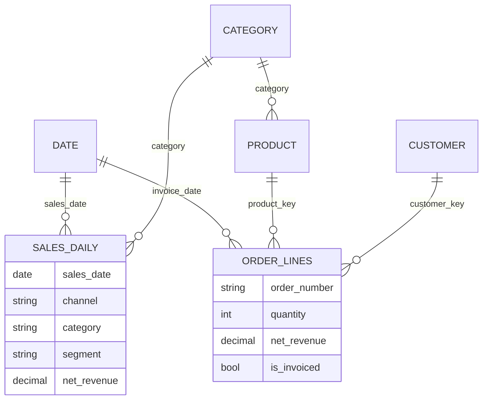

# Sales Semantic Model

The Sales Semantic Model is the certified Power BI dataset for everything about sales. It imports [mart.sales_daily](../data-warehouse/mart-sales-daily.md "reads-from") for fast daily totals, [dw.fact_orders](../data-warehouse/fact-orders.md "reads-from") for order-level detail, and the [dw.dim_customer](../data-warehouse/dim-customer.md "reads-from") and [dw.dim_product](../data-warehouse/dim-product.md "reads-from") dimensions, all from [sqldb-warehouse-prd](../infrastructure/data-stores/sqldb-warehouse-prd.md "connects-to").

## Model shape

Two fact tables share conformed dimensions: totals come from the daily aggregate, and the order-lines table is used only when a visual drills to customer or order. A small `Category` table bridges the two because the mart stores category as text.

## Key measures

| Measure | Definition |
| --- | --- |
| `Net Revenue` | Sum of net revenue from the daily aggregate |
| `Orders` | Distinct order numbers |
| `Average Order Value` | `Net Revenue / Orders` |
| `Pending Value` | Gross value of lines not yet invoiced |
| `Net Revenue LY` | Net revenue for the same period last fiscal year |
| `Growth %` | `(Net Revenue - Net Revenue LY) / Net Revenue LY` |

The fiscal year starts in April. Measures that compare periods use the fiscal calendar, never the calendar year, which is the most common source of questions from new users.

## Refresh

The model refreshes once a night when the [Master Nightly Pipeline](../pipelines/pl-master-nightly.md "refreshed-by") calls the Power BI REST API after the warehouse load. Scheduled refresh in the service is disabled so that the model never refreshes against a half-loaded warehouse. Incremental refresh keeps the order-lines table to 25 months.

## Consumers

The [Sales Performance Dashboard](./sales-performance-dashboard.md) is built on this model, and analysts with build permission create their own reports from it. It is owned by [Analytics and Reporting](../teams/analytics-and-reporting.md "owned-by").

Tags: Power BI, semantic model, sales.
