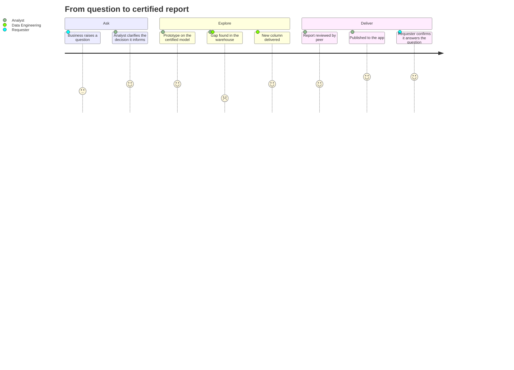

# Analytics and Reporting

Analytics and Reporting turns warehouse data into answers. The team of four analysts and a lead owns the Power BI models and reports, curates business definitions such as net revenue and churn, and supports analysts across the business who build their own reports on certified models.

## What the team owns

- The [Sales Semantic Model](../reporting/sales-semantic-model.md "owns") and its measure definitions.
- The [Sales Performance Dashboard](../reporting/sales-performance-dashboard.md "owns").
- The [Finance Month-End Pack](../reporting/finance-month-end-pack.md "owns"), with finance as business owner.
- The product category mapping used by [dw.dim_product](../data-warehouse/dim-product.md "curates").

The team leads [Customer 360](../projects/customer-360.md "leads") and validates migrated tables for [Warehouse Modernisation](../projects/warehouse-modernisation.md "supports").

## A request's journey

## Principles

Measures are defined once, in the model, never in individual reports. A figure shown to leadership must trace back to the warehouse through a documented path such as [Order Revenue Lineage](../guides/order-revenue-lineage.md). When a warehouse change is needed, the team raises it with [Data Engineering](./data-engineering.md "works-with") rather than working around it in Power Query.

Tags: team, analytics, reporting.
