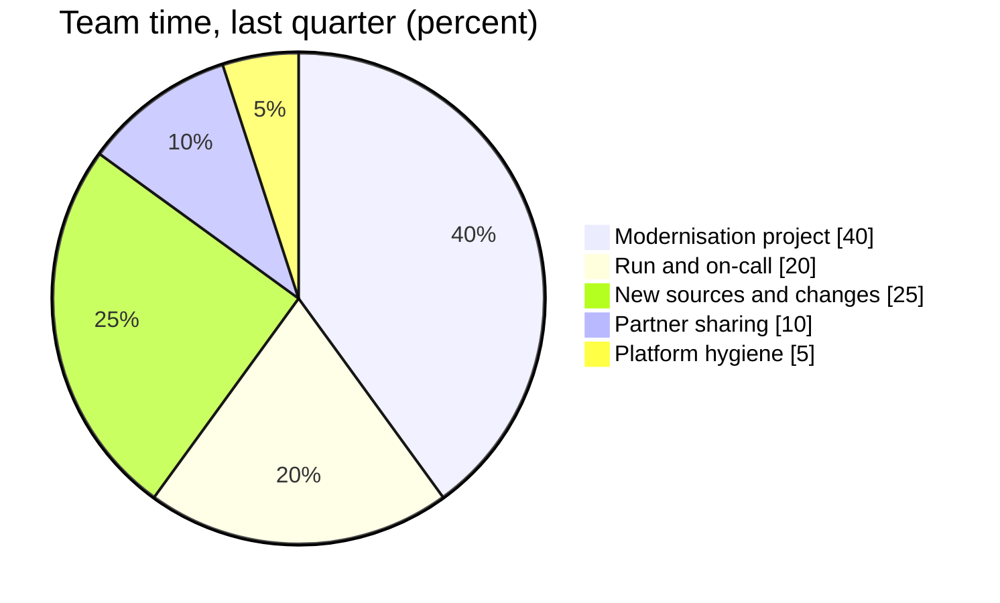

# Data Engineering

Data Engineering builds and runs the platform underneath reporting: ingestion, the lake, the warehouse and the Azure resources they run on. The team is five engineers and a lead, and runs a weekly on-call rotation for the nightly load.

## What the team owns

- The [Data Factory Pipelines](../pipelines/pipelines.md "owns") and their single schedule.
- The [Data Warehouse](../data-warehouse/data-warehouse.md "owns") schemas, from staging to marts.
- [rg-dataplatform-prd](../infrastructure/cloud/rg-dataplatform-prd.md "owns") and everything in it, including the key vault and the runtime host.
- The [Onboarding a Data Source](../guides/onboarding-a-data-source.md "owns") process.

It works with [Kestrel Managed Services](../infrastructure/vendors/kestrel-managed-services.md "works-with") on the billing replica and runtime host, and leads [Warehouse Modernisation](../projects/warehouse-modernisation.md "leads") and [Partner Data Sharing](../projects/partner-data-sharing.md "leads").

## Where the time goes

## On-call

The on-call engineer completes the morning sign-off in [Nightly Warehouse Refresh](../guides/nightly-warehouse-refresh.md) and handles failures using [Troubleshoot Failed Pipeline Runs](../guides/troubleshoot-failed-pipeline-runs.md). On-call hand-over is on Monday at 10:00, and the outgoing engineer writes a short note of anything still open.

## Working with the team

Requests for new data come through the onboarding intake; changes to existing tables come through the shared backlog with [Analytics and Reporting](./analytics-and-reporting.md "works-with"), which agrees any change that could break a report.

Tags: team, data engineering, on-call.
